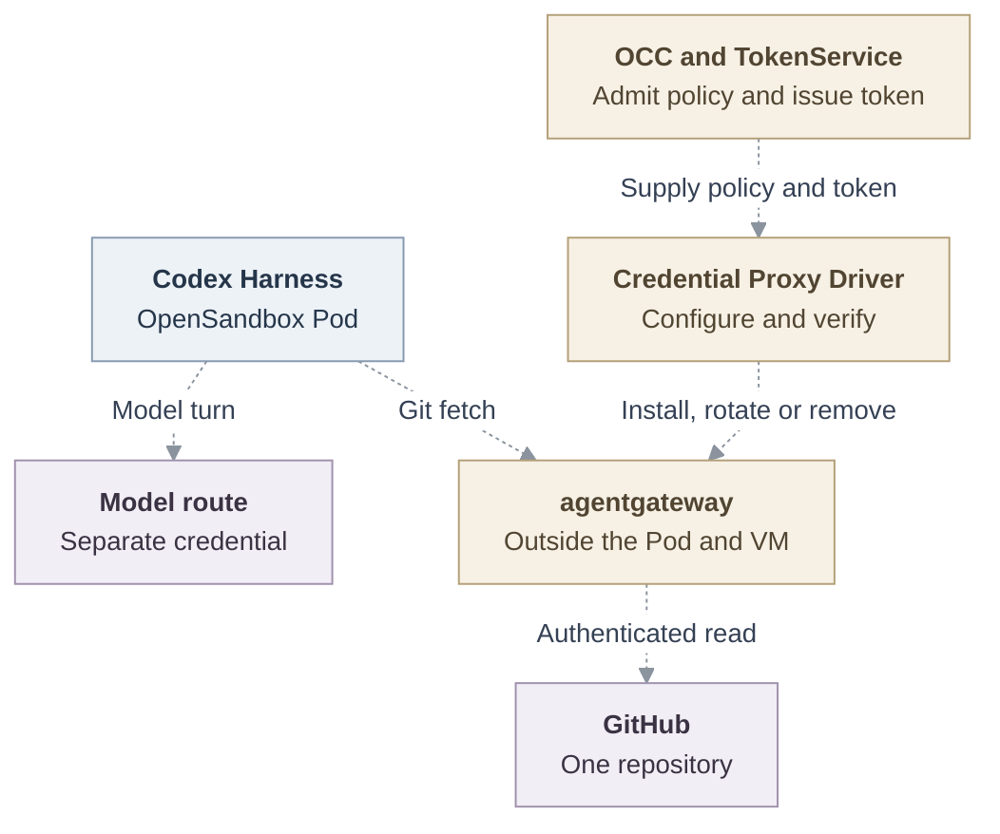

# Proposal: Run a dedicated Codex Harness in OpenSandbox

- **ID:** RFC-20261124-opensandbox-harness
- **Created:** 2026-11-24
- **Last updated:** 2026-11-25
- **Implementation plan:**
  [Delivery steps and pilot results](../plans/20261124-opensandbox-harness.md)

## Summary

Let operators select OpenSandbox as the [Sandbox Driver](../../docs/reference/drivers/sandbox.md)
for a dedicated Codex Harness. Kubernetes Compute keeps the Gateway, routing and workspace.
The OpenSandbox controller creates one Pod per Agent revision.

Start with placement and refuse protected credentials. After qualification, a dedicated
agentgateway endpoint outside the Pod and any guest VM could grant read access to one repository.

## Motivation

An Agent needs an authenticated Gateway connection, an enrolled workspace node and one workspace
writer. [Kubernetes Compute](../../docs/reference/drivers/kubernetes-compute.md#sandbox-provisioning)
already manages that lifecycle. Running individual tools in OpenSandbox would leave the Harness outside it.

## Proposal

1. **Deploy.** The worker rechecks authority. For placement alone, Compute calls
   `provisionHarness` with the admitted image, command, identity, Secret references, labels and mounts.
2. **Provision.** The Driver creates one non-pooled `BatchSandbox` in the tenant Namespace. Preserve
   restricted Pod Security and default-deny networking. After a lost reply, verify ownership and
   the template before reuse. For protected access, keep the Harness idle until both Drivers
   confirm that the policy for this sandbox is in effect.
3. **Activate.** Start the prepared Harness. Confirm Pod ownership, Gateway authentication and
   workspace node enrollment before routing.
4. **Stop.** Withdraw the route. Delete by the UID first observed for cleanup. Confirm the old Pod
   is gone before another writer starts. Retain the workspace claim across stops. Remove it on Agent deletion.

### Keep provider credentials outside the Agent

OpenClaw Control Plane (OCC) admits the policy. TokenService keeps the App signing key
and issues and renews the scoped GitHub token. The Credential Proxy Driver pushes the token and
policy to agentgateway. Git can fetch while OCC is offline. Model access stays independent.

Dashed arrows show the proposed connections.

- **Caller.** Bind access to the Installation, Namespace, Agent, revision and sandbox instance.
  Enforce the executable rule in the Sandbox. A client certificate alone cannot identify a program.
  Block direct egress, proxy administration and access by other workloads.
- **Requests.** Pin the repository ID and name. Grant only contents and metadata reads.
  Check the authority, method and exact `pathAndQuery` over HTTP/2 before injection.
  Allow only `GET /OWNER/REPO.git/info/refs?service=git-upload-pack` and
  `POST /OWNER/REPO.git/git-upload-pack`. Reject caller-supplied authorization, redirects and ambiguous targets.
  Verify upstream TLS. Reject malformed replies and credential leaks.
- **Withdrawal.** Enforce a local deadline no later than token expiry. Recheck grants before renewal.
  Verify the policy and token version on every serving copy. Confirm that withdrawal blocks new reads
  across restarts. An authorized send may finish. If denial is uncertain, isolate the endpoint,
  stop the execution and keep withdrawal pending. Otherwise preserve chat and other Agents’ access.

## Interface changes

### APIs

No changes. Use existing Agent, Credential Source and repository operations.

### IAM

No changes. Keep exact resource checks for the deploying actor and Agent service principal.

### Database entities

No changes. The [existing staged revision](https://github.com/openclaw/openclaw-enterprise/blob/454af32efaf499b367f8d435434ce633e8a09ed6/packages/contracts/src/credential-deployment.ts#L129-L179)
can record separate model and repository bindings.

### Driver contracts

Use the [existing package loader](../../docs/reference/drivers/selection.md#select-the-installed-driver).
The placement pilot refuses protected inputs. Two requirements need review.

1. **Pod ownership.** Compute must verify that the selected Pod belongs to the original
   `BatchSandbox` UID at readiness and activation. Restrict changes to Pod labels, Service selectors
   and ownership metadata. Add the optional `confirmHarnessPod` check for Compute-owned storage.
   Pass the Namespace, revision, Pod name and UID.
   Block routing on uncertainty. Other Drivers keep their existing behavior.
2. **Protected access.** Register `sandbox` and `credential_proxy_delivery` together. Use the
   existing staged operations. Keep the legacy `credential_proxy` path unchanged. Qualify the
   complete policy and mandatory routing before admitting this pair. Today the
   [qualifier accepts only OpenShell](https://github.com/openclaw/openclaw-enterprise/blob/454af32efaf499b367f8d435434ce633e8a09ed6/apps/controller/src/composition/openshell-credential-admission.ts#L25-L49).
   Qualification of other pairs is [deferred until after 1.0](https://github.com/openclaw/openclaw-enterprise/blob/454af32efaf499b367f8d435434ce633e8a09ed6/docs/reference/credential-sources.md#implementation-status).

See the [credential design](../../docs/reference/credential-sources.md#implementation-status) and the
related proposals for
[external Sandboxes](https://github.com/openclaw/openclaw-enterprise/pull/6346),
[Strands Box](https://github.com/openclaw/openclaw-enterprise/pull/6505) and
[Sandbox and credential delivery](https://github.com/openclaw/openclaw-enterprise/pull/7209).

## Simplifications

The operator avoids a second lifecycle server. A dedicated Git endpoint avoids sending model
traffic through OpenSandbox forward mode. For VM isolation alone, try a Kata RuntimeClass first.

## Acceptance Criteria

- **AC-1. Docker.** Verify Codex startup, authentication, refusal and deletion.
- **AC-2. Agent.** Deploy through OCC. Verify chat, workspace access and policy enforcement.
  Refuse a foreign Pod, invalid identity or bearer, stale revision, missing node or unsupported policy.
- **AC-3. Recovery.** Lose create and delete replies. Preserve one writer, files and foreign resources.
- **AC-4. Protected access.** Fetch through the installed pair without Pod exec or a callback to OCC.
  Verify custody, executable identity, rotation, expiry and zero forbidden requests at the origin.
  Test withdrawal with a valid token, continued chat, peer access and stop on failed withdrawal.
- **AC-5. VM.** Repeat AC-2 through AC-4 in a verified guest. Refuse a missing runtime handler.
  Verify guest termination and volume reassignment after node loss.

## Delivery and verification

The [plan](../plans/20261124-opensandbox-harness.md) separates pilot evidence from the checks
required before production use. A human must merge this RFC.
