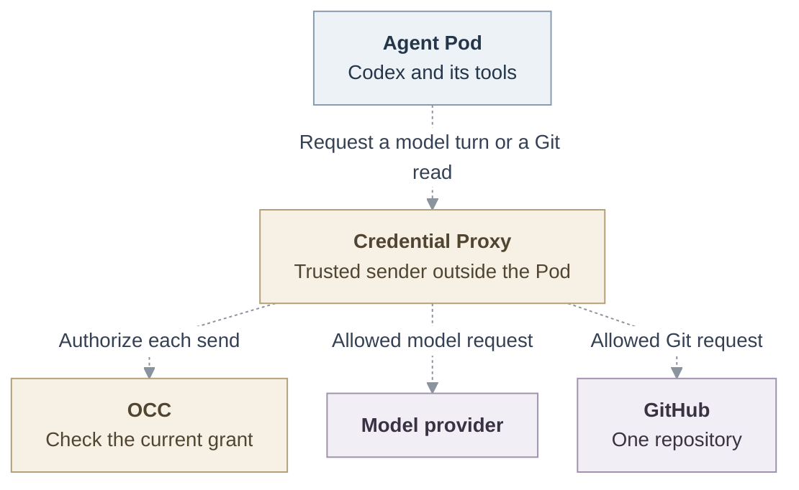

# Proposal: Run a dedicated Codex Harness in OpenSandbox

- **ID:** RFC-20261124-opensandbox-harness
- **Created:** 2026-11-24
- **Last updated:** 2026-11-24
- **Implementation plan:**
  [Delivery steps and pilot results](../plans/20261124-opensandbox-harness.md)

## Summary

Let operators select OpenSandbox as the [Sandbox Driver](../../docs/reference/drivers/sandbox.md)
for a dedicated Codex Harness. The OpenSandbox controller creates one Pod per Agent revision.
Kubernetes Compute keeps the Gateway, routing and workspace. For protected access,
OpenClaw Control Plane (OCC) must let an operator withdraw Git without interrupting chat
or another Agent's access.

## Motivation

An Agent needs an authenticated Gateway connection, an enrolled workspace node and one workspace
writer. [Kubernetes Compute](../../docs/reference/drivers/kubernetes-compute.md#sandbox-provisioning)
already manages that lifecycle. Running individual tools in OpenSandbox would leave the Harness outside it.

## Proposal

1. **Deploy.** The worker rechecks authority and passes the admitted image, command, identity,
   Secret references, labels and mounts to `provisionHarness`.
2. **Start.** Create one non-pooled `BatchSandbox` in the tenant Namespace. Preserve restricted
   Pod Security and default-deny networking. After a lost reply, verify ownership and template before reuse.
3. **Activate.** Confirm Pod ownership, Gateway authentication and workspace node enrollment before routing.
4. **Stop.** Withdraw the route. Delete by the UID first observed for cleanup and confirm the old Pod is gone before another writer starts.
   Retain the claim across stops. Remove it on Agent deletion.

### Keep provider credentials outside the Agent

The pilot used an operator-managed tool. The proposed serving path requires no Pod exec access.

TokenService owns the model Credential Source independently of Sandbox selection. The GitHub Backend
keeps the App signing key and issues a token for the approved repository. Only the trusted sender
adds a provider credential to an authorized request. The Harness may hold a credential for its own
connection to the sender. Providers must reject it.

Authenticate the sender and the running execution. Bind each grant to its Installation, Namespace,
Agent, revision, process, network and policy generation. A change of controller, Pod or execution
invalidates the binding until the new recipient is verified. Check repository ID and operation on every request.
Validate responses before returning them to the authenticated recipient. Reject malformed responses
and any that expose credentials. Block direct provider and control-plane access. Refuse restrictions the sender cannot enforce.
After withdrawal, deny new Git requests even if the token works. An authorized send in progress may
finish. Persist the reduction across restarts. Stop serving if enforcement fails.

## Interface changes

### APIs

No changes. Use existing Agent, Credential Source and repository operations.

### IAM

No changes. Keep exact resource checks for the deploying actor and Agent service principal.

### Database entities

Version the Agent revision to pin both grants, the Source owner, the Driver pair and required capabilities. Refuse unknown versions.

### Driver contracts

Use the [existing package loader](../../docs/reference/drivers/selection.md#select-the-installed-driver).
The placement pilot refuses protected inputs. Review three changes.

1. **Pod ownership.** Add an optional `confirmHarnessPod` check for Compute-owned storage.
   Pass the Namespace, revision, and selected Pod name and UID. OpenSandbox must verify the Pod's
   controller against the originally observed `BatchSandbox` UID at readiness and activation. Block routing on
   uncertainty. Restrict writes to Pod labels, Service selectors and ownership metadata throughout the revision.
   Other Drivers keep their existing behavior.
2. **Model access.** Keep new Sources with TokenService and preserve existing Source owners.
   Register the Sandbox and Credential Proxy together. Verify the recipient, model route and credential
   delivery before release. Refuse direct provider keys and missing senders.
3. **Git access.** Extend `github-repository` to support read-only `exact-dispatch`. Each permit
   authorizes one request with a deadline to start. Require the running sender to support
   `policyReduction` version 2 so it can remove Git alone. Refuse combined admission if either
   capability is missing. Never widen the repository grant.

Keep existing admission versions unchanged. See the
[credential design](../../docs/reference/credential-sources.md#implementation-status) and the
related proposals for
[external Sandboxes](https://github.com/openclaw/openclaw-enterprise/pull/6346),
[Strands Box](https://github.com/openclaw/openclaw-enterprise/pull/6505) and
[Sandbox and credential delivery](https://github.com/openclaw/openclaw-enterprise/pull/7209).

## Simplifications

Using the operator directly avoids a second allocation service, execution daemon and workspace owner.
For VM isolation alone, first test the existing Harness with a VM-backed RuntimeClass such as Kata.

## Acceptance Criteria

- **AC-1. Docker.** Start the pinned runtime, authenticate to Codex, refuse missing and incorrect
  credentials, and verify deletion.
- **AC-2. Agent.** Deploy through OCC and its worker. Verify chat, workspace reads and writes, and
  allowed and denied traffic. Refuse a foreign Pod, wrong identity or revision, invalid bearer,
  missing node or unsupported policy.
- **AC-3. Recovery.** Lose create and delete replies. Verify one writer, preserve the file across
  replacement and stop, and leave foreign resources intact.
- **AC-4. Protected access.** Have Codex fetch through the installed pair. Verify provider
  credentials stay outside the Agent. Deny other repositories, writes, bypass attempts and credential reflection. Withdraw
  Git through OCC while the token works. Verify refusal, continued chat and a second Agent's access.
- **AC-5. VM.** Repeat AC-2 through AC-4 in a verified guest. Check missing handler refusal, volume
  reassignment and guest termination after node failure.

## Delivery and verification

The [plan](../plans/20261124-opensandbox-harness.md) separates pilot evidence from the checks
required before production use. A human must merge this RFC.
