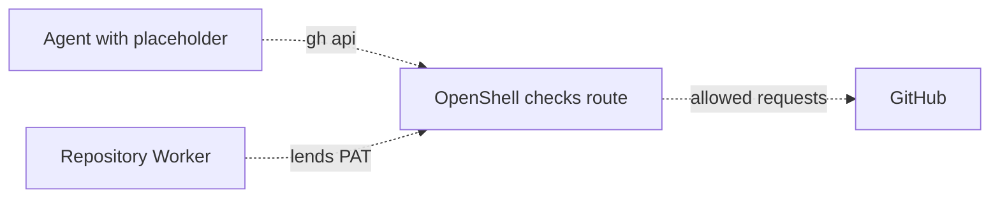

# Proposal: GitHub repository APIs with a managed static Source

- **ID:** RFC-20261124-pat-repository-api
- **Created:** 2026-11-24
- **Last updated:** 2026-11-24
- **Related:** [Managed static GitHub Source proposal](https://github.com/openclaw/openclaw-enterprise/pull/7149), [Source enrollment](https://github.com/openclaw/openclaw-enterprise/pull/7152), [Git delivery](https://github.com/openclaw/openclaw-enterprise/pull/7153), [repository network policy](20261119-repository-network-policy.md), [issue and PR access](20261123-repository-issue-creation.md)

## Decision

Let an Agent use stock `gh api` to read and create issues and pull requests (PRs) without receiving the personal access token (PAT). Keep Git-only grants Git-only until an operator enrolls API access and an editor selects it.

The GitHub App path is on main. [The PAT implementation](https://github.com/openclaw/openclaw-enterprise/pull/7247) depends on the pending [Source proposal](https://github.com/openclaw/openclaw-enterprise/pull/7149), [enrollment](https://github.com/openclaw/openclaw-enterprise/pull/7152) and [Git delivery](https://github.com/openclaw/openclaw-enterprise/pull/7153).

## How access works

Enroll a dedicated fine-grained PAT with a ceiling such as `acme/docs:read:api,acme/web:write:api`. Omit `:api` for Git only. At enrollment and replacement, verify the resource owner, match the **selected repositories** in GitHub to the declared set and grant the minimum permissions. Stop if you cannot verify them. OCE cannot measure or reduce the token's rights. [GitHub also grants public read access](https://docs.github.com/en/authentication/keeping-your-account-and-data-secure/managing-your-personal-access-tokens#creating-a-fine-grained-personal-access-token). That does not open a Sandbox route.

The Source ceiling, Installation ceiling, Namespace registration and saved Agent grant all apply. Set `permissions.issues` and `permissions.pull_requests` independently. Repositories sharing a token need identical permission maps.

| Agent grant | Direct requests where the corresponding permission allows them                                      |
| ----------- | --------------------------------------------------------------------------------------------------- |
| Read        | List or read an issue or PR, for example `gh api repos/acme/docs/issues`                            |
| Write       | Also create an issue or PR, for example `gh api --method POST repos/acme/web/pulls --input pr.json` |
| None        | No direct Git or API access                                                                         |

Namespace and Agent `apiLimits` can narrow access. Set `issues` to `read` to disable direct issue creation. For Git only, replace the **entire** limits object with `{"default":"none"}`. Resource overrides take precedence.

The repository Worker owns one endpointless Provider for Git and REST. Reuse [its revision copy record, Source lock, expiry and retirement checks](https://github.com/openclaw/openclaw-enterprise/blob/a448eac9fdc6ac4040a37f89907432d5da8bf421/docs/reference/repository-credentials/repository-token-source.md). The Sandbox binds the routes. Stock OpenShell 0.1.9 inspects TLS and injects the PAT. There is no second Credential Proxy copy or request-time OCE callback.

## Interface changes

### APIs

Expanding API access or changing the repository set while retaining API access requires a new Source. For API-enabled PAT registrations, the catalog reference identifies the grant. If the Source, permissions or limits change that identity, select the repository again before deploying, even on first deployment. Same-scope token rotation preserves the selection. Before upgrading, rename and reselect any configured `repositoryRef` matching `pat-api-` plus 64 lowercase hexadecimal digits. This form is reserved.

### IAM

No new action. Changing the binding set while retaining PAT API access over a saved policy requires Agent update, `manage_policy` and SandboxPolicy read and update. Clearing all bindings remains possible. Preserve caller and Agent Source `operate` checks.

### Database entities

No changes.

### Driver contracts

Repo resolves the catalog selection. Check the ceiling at policy save, deploy and each locked loan. Keep the App safeguard. An ungranted binding suppresses PR creation. If PR creation remains eligible but a declared Source repository lacks a grant, refuse admission and renewal. Limit PRs to reads or use a narrower Source. Eligible issue creation remains independent.

## Simplifications

Reuse the native route compiler, TokenService and stock clients. GraphQL, editing and merging PRs are outside this proposal. Stricter body and query rules belong upstream in OpenShell.

## Acceptance criteria

1. **Adoption.** Upgrade a Git-only Agent. Verify Git still works and REST stays denied. Reject a stale selection on first deploy and redeploy. Require a policy editor to adopt the new selection. Restoring a registration must not restore a withdrawn grant.
2. **Direct access.** With a controlled origin, give the same Agent Read on A and Write on B. Exclude private C from the token, bindings and grants. Verify issue and PR reads, push to B, and independently read back a new issue and PR. Deny writes to A and direct access to C with zero forbidden origin hits. Verify limits, both PR safeguards, no raw token in the workload and zero OCE callbacks.
3. **Rotation and withdrawal.** Keep the old synthetic token valid. Verify the replacement authenticates REST requests without logging either value. Downgrade B and redeploy. Check old Sandbox retirement, successful reads and denied push and POST. Withhold credentials on uncertain policy or recipient identity. Stop and verify retirement after an uncertain Provider write.
4. **Indirect effects.** GitHub interprets request fields. A PR on B can name a fork head or convert an issue even when direct issue creation is disabled. A parent link can affect read-only A. An overbroad PAT could expose private C. Inspect A, B and C after each case and any triggered workflows. Before broader rollout, require separately authorized GitHub evidence that A stayed unchanged and C was neither exposed nor changed. A fixture alone cannot establish this.

Review and merge this RFC manually. Land the Git-only dependencies before #7247. Installed PAT behavior and live GitHub effects remain unverified.
