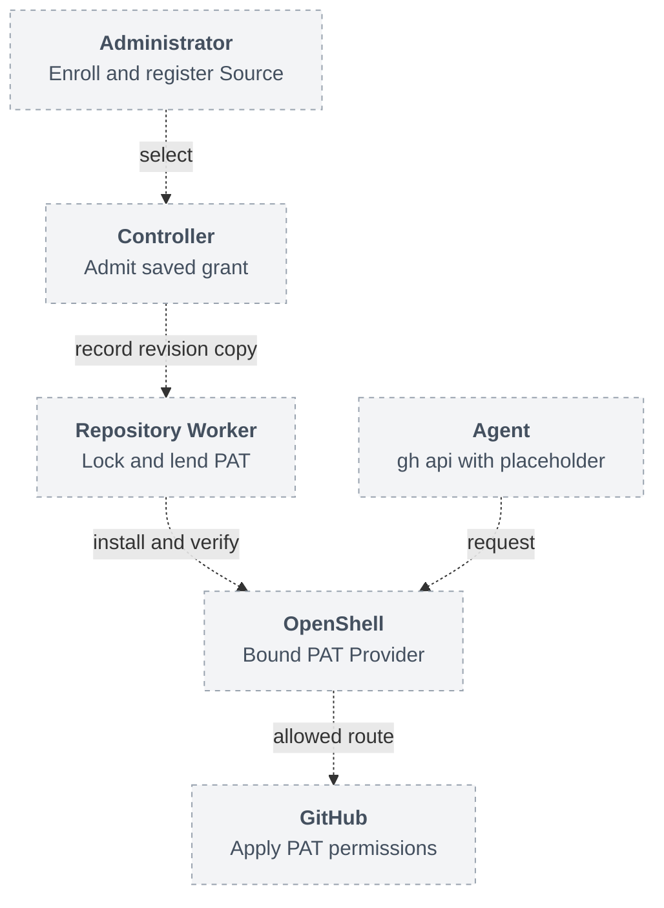

# Proposal: GitHub repository APIs with a managed static Source

- **ID:** RFC-20261124-pat-repository-api
- **Created:** 2026-11-24
- **Last updated:** 2026-11-24
- **Related:** [Managed static GitHub Source proposal](https://github.com/openclaw/openclaw-enterprise/pull/7149), [Source enrollment](https://github.com/openclaw/openclaw-enterprise/pull/7152), [Git delivery](https://github.com/openclaw/openclaw-enterprise/pull/7153), [repository network policy](20261119-repository-network-policy.md), [issue and PR access](20261123-repository-issue-creation.md)

## Summary

An administrator should be able to give an Agent Git, Issues and Pull requests access through a managed GitHub personal access token (PAT), without putting the token in the Agent. This proposal adds an explicit `:api` ceiling to the proposed `github` managed static Source. The Namespace registration, saved Agent grant and existing `apiLimits` select the direct requests that stock OpenShell permits. Bare repository entries remain Git-only.

This proposal builds on the [Source RFC #7149](https://github.com/openclaw/openclaw-enterprise/pull/7149), [enrollment #7152](https://github.com/openclaw/openclaw-enterprise/pull/7152) and [repository Worker delivery #7153](https://github.com/openclaw/openclaw-enterprise/pull/7153). These dependencies are still open. [#7247](https://github.com/openclaw/openclaw-enterprise/pull/7247) extends that Git-only stack and reuses the GitHub App route rules already on main.

## Proposal

### Enroll and adopt the Source

Enroll a dedicated fine-grained PAT with a `repositories` ceiling, as in this example.

```text
acme/docs:read:api,acme/web:write:api
```

The `:api` suffix permits eligible Issues and Pull requests routes. The suffix alone grants no route. A bare entry such as `acme/tools:write` permits Git only.

Before enrollment and every token replacement, the operator checks GitHub's selected repository list for the chosen resource owner against the declared set and checks the resource permissions. Stop if these cannot be confirmed. [GitHub fine-grained PATs](https://docs.github.com/en/authentication/keeping-your-account-and-data-secure/managing-your-personal-access-tokens#creating-a-fine-grained-personal-access-token) also have read access to public repositories. OpenShell still checks each direct route. OCE cannot attest the token's actual scope, detect extra rights or shrink it. TokenService keeps the real token outside the Agent workload.

A Source update or token rotation cannot add `:api`, raise an enrolled API entry from Read to Write, or change the repository set while API access remains enabled. Enroll a new Source for those changes. This also prevents removing a declaration solely to enable PR creation without reducing the PAT's GitHub scope. A same-scope token replacement retains the ceiling and repeats the operator check.

Changing a registration must not turn an old Git selection into permission to open a PR on the next deployment. For a PAT registration that permits API routes, the picker returns an opaque repository reference tied to the registration's grant identity. That identity includes the Source ID, repository, Namespace, permissions and API limits. Rotating the secret within the same scope keeps the reference valid.

When the identity changes, a saved selection no longer matches. This applies even to a draft that has never deployed. Select the repository again from the catalog and deploy. If the Agent already has a saved repository policy, the person selecting the new API access needs the permissions required to review and apply that policy. They can keep the Agent Git-only with `apiLimits.default: "none"`. Removing access and stopping the Agent must remain possible. Git-only and App registrations keep their existing references.

### Select direct routes

For each repository and resource, intersect the enrolled Source ceiling, Namespace ceiling and `permissions`, saved Agent Read or Write grant, and Namespace and Agent `apiLimits`.

| Effective access | Eligible direct API requests under `/repos/{owner}/{repo}`                                            |
| ---------------- | ----------------------------------------------------------------------------------------------------- |
| Read             | GET `/issues`, `/issues/{number}`, `/pulls`, `/pulls/{number}` where the resource has read permission |
| Write            | The eligible GETs and POST `/issues` or `/pulls` where the resource has write permission              |
| None             | No API routes                                                                                         |

Set `permissions.issues` and `permissions.pull_requests` independently on the Namespace registration. A saved Write grant permits creation by default where the Source and Namespace allow it. Use `apiLimits.issues: read` to disable issue creation while retaining eligible PR creation, or restrict Pull requests independently. Limits cannot expand permissions. Git access retains its existing checks.

Use the same token permission map across repositories that share a token. For example, grant the Agent Read on `acme/docs` and Write on `acme/web`, with matching Namespace permissions. After deployment, stock `gh api repos/acme/docs/issues` can list issues. With Pull requests Write on `acme/web`, `gh api --method POST repos/acme/web/pulls --input pr.json` can open a PR. A direct POST to `acme/docs` is denied. The Agent uses a placeholder. OpenShell injects the PAT only after allowing the route.

Save, deploy and each locked Source loan must refuse operations outside the intersection. The Sandbox compiles exact repository routes and binds them to the revision's endpointless PAT Provider. The **repository Worker** owns that Provider for Git and REST together, using the same deployed-copy record, Source lock, loan expiry, replacement, retirement readback and `write_unknown` fence described in [#7153](https://github.com/openclaw/openclaw-enterprise/blob/a448eac9fdc6ac4040a37f89907432d5da8bf421/docs/reference/repository-credentials/repository-token-source.md#admission-and-renewal). A `github` Source has no Credential Proxy Provider. Stock OpenShell 0.1.9 inspects TLS, enforces the loaded rules and injects the token. OCE makes no request-time GitHub authorization callback. If it cannot verify the policy, recipient or lock, the Worker must withhold the credential. If a Provider write has an unknown result, do not retry it. Stop the Agent and verify Sandbox retirement before redeploying.

The proposed flow uses one Provider per revision.



### Preserve the PR safeguard

Keep the merged GitHub App rule unchanged. A bound repository without an Agent grant suppresses PR creation everywhere while eligible issue creation remains available. For a PAT, also refuse a delivery that would create PRs if the Source declares a repository outside the Agent's grants, including an unbound repository. Restrict Pull requests to Read or enroll a matching Source. This adds no global issue veto.

## Risks and limits

OpenShell checks direct methods and paths. It does not restrict JSON fields or their query equivalents. A permitted B request can refer to read-only A or denied private C through a PR fork head, an issue parent, issue conversion or a workflow. A correctly selected PAT can still affect A because A is in its selected set. A mis-scoped token might expose or affect C. PR creation can convert an issue even when issue creation is disabled. GitHub's public repository read access also remains part of the token's upstream authority.

Maintainers must hold broader rollout if read-only A changes, private C is exposed or changed, or those effects remain unverified. To lift the hold, obtain separately authorized live GitHub evidence with A Read, B Write and private C excluded from the PAT selection, bindings and grants. Inspect B and both protected repositories after each relevant parent-link, fork-head, issue-conversion and workflow case, using an independent authorized observer, and record what GitHub accepted or refused. A controlled fixture can prove direct enforcement and modeled effects. It cannot settle GitHub's live behavior. GraphQL, PATCH, DELETE, merge operations and strict body or query restrictions are outside this proposal.

## Interface changes

### APIs

Extend Source enrollment to accept `owner/name:read:api` and `owner/name:write:api` in `repositories`, with ceiling readback and the update restrictions above. Reuse existing Namespace permissions, grant preview, save, deploy and `apiLimits` interfaces. API callers select the repository reference returned by the catalog. A stale selection requires a fresh choice before deployment.

### IAM

No new IAM action. Selecting a new API-enabled PAT binding over a saved repository policy requires the existing Agent `manage_policy` and SandboxPolicy `read` and `update` permissions, in addition to Agent update. Keep Source `operate` checks for the caller and Agent.

### Database entities

No changes. No database migration.

### Driver contracts

Tie the repository catalog reference to the grant for API-enabled PAT registrations. Extend managed static GitHub Source admission and locked credential loans for the explicit API ceiling and declared repository set. Reuse the native Sandbox compiler and the repository Worker's Provider lifecycle.

## Simplifications

Reuse the Git-only Source, TokenService, repository syntax, permission intersection and native REST compiler. No extra credential type, approval field, broker, request handler or OpenShell fork.

## Acceptance Criteria

These are required outcomes for qualification.

- **AC-1 · Enrollment and compatibility.** Enroll a bare Git-only Source, save and deploy an Agent, then upgrade and redeploy without changing the registration. Verify Git succeeds and REST is denied before the origin on both deployments. Reject malformed ceilings and API expansion through update or rotation. Point the same registration at a new API-enabled Source. Refuse first deploy and redeploy under the stale selection, and refuse re-selection by an editor who cannot manage the saved policy. Verify REST appears only after authorized selection and deployment. Restoring a registration must never restore a cleared grant. Check operator scope confirmation, withdrawal and cleanup.
- **AC-2 · Direct authority.** Save and deploy one Agent with A Read, B Write and private C outside the PAT selection, bindings and grants. Through stock OpenShell and a controlled origin, verify A and B list/detail reads, B push and issue/PR creation, direct denials for A writes and C access, independent resource limits, placeholder use, no request-time OCE callback and absence of the PAT from the workload.
- **AC-3 · Replacement and downgrade.** Replace the PAT with a distinguishable same-scope value. Independently observe the new value at the controlled origin without exposing it to the Agent. Confirm Worker delivery and verify that fresh requests use the new value after confirmation. Downgrade B, redeploy the same Agent and verify retirement of the old Sandbox. B reads continue. Fresh POSTs stop before the origin. Git follows the reduced grant. Refuse stale loans and unverifiable policy. After withdrawal, issue and renew nothing. Confirm the installed copy retires or expires. Exercise the unknown-write fence without replay.
- **AC-4 · Indirect effects and rollout.** Verify both PR safeguards and eligible B issue creation while PR creation is disabled. In a controlled fixture, inspect A, B and C after modeled parent-link, fork-head, issue-conversion and workflow cases. Record direct denials separately from indirect effects. Keep broader rollout on hold until the separately authorized live GitHub evidence in **Risks and limits** establishes that A did not change and C was neither exposed nor changed.

## Delivery and verification

This RFC needs human architectural review and manual human merge. The pending Git-only prerequisites must land before their API extension. The implementation proposal contains source and controlled conformance coverage. Neither that evidence nor hosted CI proves an installed PAT workflow or live GitHub effects. This RFC authorizes no deployment, live GitHub writes or broader rollout.
