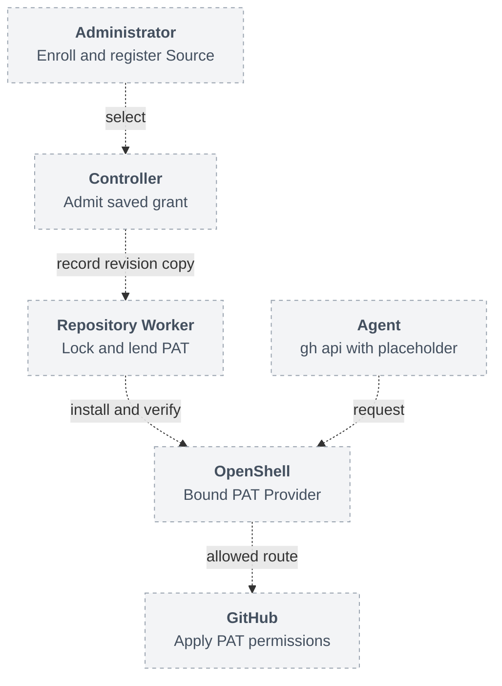

# Proposal: GitHub repository APIs with a managed static Source

- **ID:** RFC-20261124-pat-repository-api
- **Created:** 2026-11-24
- **Last updated:** 2026-11-24
- **Related:** [Managed static GitHub Source proposal](https://github.com/openclaw/openclaw-enterprise/pull/7149), [Source enrollment](https://github.com/openclaw/openclaw-enterprise/pull/7152), [Git delivery](https://github.com/openclaw/openclaw-enterprise/pull/7153), [repository network policy](20261119-repository-network-policy.md), [issue and PR access](20261123-repository-issue-creation.md)

## Summary

Let an Agent use stock `gh api` to read and create issues and pull requests without receiving a GitHub personal access token (PAT). An operator opts in per repository with `:api`. An Agent editor chooses the repository and grants Read or Write. A routine upgrade cannot turn an existing Git-only grant into permission to open a pull request.

The GitHub App path is on main. The PAT path depends on the pending [Source proposal](https://github.com/openclaw/openclaw-enterprise/pull/7149), [enrollment](https://github.com/openclaw/openclaw-enterprise/pull/7152) and [Git delivery](https://github.com/openclaw/openclaw-enterprise/pull/7153). [The API implementation](https://github.com/openclaw/openclaw-enterprise/pull/7247) builds on that stack.

## Proposal

### Enroll the token

For example, enroll `acme/docs:read:api,acme/web:write:api`. A bare entry such as `acme/tools:write` stays Git-only. Adding API access, expanding it from Read to Write or changing the repository set while retaining API access requires a new Source.

Use a dedicated fine-grained PAT. At enrollment and replacement, check the resource owner, match GitHub's **selected repositories** to the declared set and grant the minimum permissions. Stop if you cannot verify them. [GitHub also grants read access to public repositories](https://docs.github.com/en/authentication/keeping-your-account-and-data-secure/managing-your-personal-access-tokens#creating-a-fine-grained-personal-access-token). That does not open a direct route in the Sandbox. OCE cannot verify or reduce the token's upstream permissions.

### Adopt the grant

For a PAT registration with API routes, the catalog returns a repository reference tied to the grant identity, including the Source ID, repository, Namespace, permissions and API limits. If the registration changes that identity, an old selection fails even on the first deployment of a saved draft. Select the repository again and deploy. Git-only and App registrations keep their existing references. Replacing the token within the same scope preserves the selection.

To keep an Agent Git-only, **replace** its grant’s entire `apiLimits` with `{"default":"none"}`. A resource-specific override takes precedence over the default.

### Select direct routes

For each repository and resource, intersect the enrolled Source ceiling, Namespace ceiling and `permissions`, saved Agent Read or Write grant, and Namespace and Agent `apiLimits`.

| Effective access | Eligible direct API requests under `/repos/{owner}/{repo}`                                            |
| ---------------- | ----------------------------------------------------------------------------------------------------- |
| Read             | GET `/issues`, `/issues/{number}`, `/pulls`, `/pulls/{number}` where the resource has read permission |
| Write            | The eligible GETs and POST `/issues` or `/pulls` where the resource has write permission              |
| None             | No API routes                                                                                         |

Set `permissions.issues` and `permissions.pull_requests` independently. Write permits creation by default where the Source and Namespace allow it. Set `apiLimits.issues` to `read` to disable direct issue creation while keeping eligible PR creation. Repositories sharing a token need identical registration permission maps.

For example, `gh api repos/acme/docs/issues` lists issues with Read. With Write on `acme/web`, `gh api --method POST repos/acme/web/pulls --input pr.json` can open a PR. A direct POST to the read-only repository is denied.

The **repository Worker** owns one endpointless Provider per revision for Git and REST. It reuses [the copy record, Source lock, expiry and retirement checks](https://github.com/openclaw/openclaw-enterprise/blob/a448eac9fdc6ac4040a37f89907432d5da8bf421/docs/reference/repository-credentials/repository-token-source.md#L69-L101). There is no second Credential Proxy copy. The Sandbox binds exact routes to the Provider. Stock OpenShell 0.1.9 checks each request and replaces the placeholder only on an allowed route. No request-time OCE callback is needed.

The proposed flow is shown below.

### Preserve the PR safeguard

If a bound repository lacks a saved grant, suppress PR creation across the binding as on the App path. If PR creation remains enabled and the PAT Source declares an ungranted repository outside the binding, refuse admission and renewal. Limit PRs to reads or enroll a narrower Source. Eligible issue creation can continue when PR creation is disabled.

## Risks and limits

Suppose the Agent can read A, write B and has no grant on private C. OpenShell checks direct methods and paths. GitHub interprets the body and query. A request to B can name a fork head, convert an issue to a PR or link a parent issue. A correctly selected token may still let an issue on B change a relationship on read-only A. An overbroad token could expose commits from C through a PR on B. Workflows can also have indirect effects. Disabling direct issue creation does not prevent issue conversion. Strict field checks would require upstream OpenShell support. GraphQL, PATCH, DELETE and merge routes stay outside this proposal.

## Interface changes

### APIs

Extend Source enrollment to accept `owner/name:read:api` and `owner/name:write:api` in `repositories`, with ceiling readback and the update restrictions above. Reuse existing Namespace permissions, grant preview, save, deploy and `apiLimits` interfaces. API callers select the repository reference returned by the catalog. A stale selection requires a fresh choice before deployment.

### IAM

No new IAM action. Selecting a new API-enabled PAT binding over a saved repository policy requires the existing Agent `manage_policy` and SandboxPolicy `read` and `update` permissions, in addition to Agent update. Keep Source `operate` checks for the caller and Agent.

### Database entities

No changes. No database migration.

### Driver contracts

Tie the repository catalog reference to the grant for API-enabled PAT registrations. Extend managed static GitHub Source admission and locked credential loans for the explicit API ceiling and declared repository set. Reuse the native Sandbox compiler and the repository Worker's Provider lifecycle.

## Simplifications

Reuse the Git-only Source, TokenService, repository syntax, permission intersection and native REST compiler. No extra credential type, approval field, broker, request handler or OpenShell fork.

## Acceptance Criteria

- **AC-1 · Adoption.** Verify an unchanged Git-only Source still fetches after upgrade and has no API access. Change the registration to an API-enabled Source under the same configured name. Reject first deploy and redeploy with the old selection. Require a policy editor to adopt the new selection. Restoring a registration must not restore a withdrawn grant.
- **AC-2 · Direct access.** Use a controlled origin on stock OpenShell. Give one saved Agent Read on A and Write on B. Leave C outside the token, bindings and grants. Read issues and PRs, push to B and create one issue and one PR there. Independently verify both writes. Require zero forbidden requests at the origin for writes to A and direct access to C. Check resource limits, both PR safeguards, placeholder isolation and zero OCE callbacks.
- **AC-3 · Rotation and withdrawal.** Keep the old synthetic value valid. Verify the origin receives the replacement on REST requests without logging either value. Downgrade B and redeploy. Verify old Sandbox retirement, successful reads and denied push and POST. After withdrawal, refuse new loans and confirm installed access ends. An uncertain Provider write must block retry until retirement.
- **AC-4 · Indirect effects.** Exercise fork heads, parent issues, issue conversion and workflows. Inspect A, B and C after each case. A fixture establishes only the effects it models. Before broader rollout, require separately authorized GitHub evidence that read-only A did not change and private C was neither exposed nor changed. Keep the rollout restricted if either outcome is unknown.

## Delivery and verification

Review and merge this RFC manually. Land the Git-only dependencies before the implementation. The installed PAT journey and live GitHub checks remain to be demonstrated.
