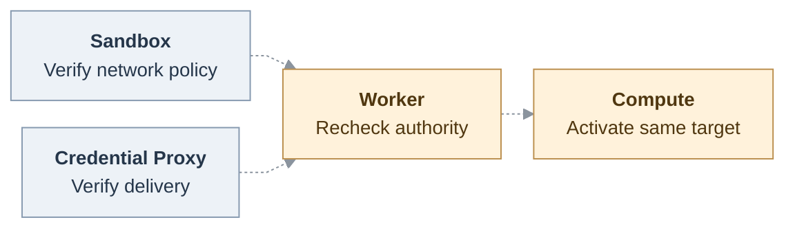

# Proposal: Sandbox and Proxy pairs

- **ID:** RFC-20261124-pluggable-sandbox-credential-delivery
- **Created:** 2026-11-24
- **Last updated:** 2026-11-24
- **Related:** [RFC-0023: Credential Proxy and credential lifecycle](0023-egress-proxy-credential-lifecycle/index.md)

## Summary

Let an administrator deploy a saved Agent through a compatible external Sandbox and Credential Proxy pair. Under RFC-0023, the pair must prove it can enforce the saved policy and keep reusable credentials outside every Agent process. The [Strands proposal](https://github.com/openclaw/openclaw-enterprise/pull/6505) owns Box-specific implementation.

## Motivation

| Current dependency                                                                                                                                                       | What a second provider needs                                 |
| ------------------------------------------------------------------------------------------------------------------------------------------------------------------------ | ------------------------------------------------------------ |
| [Package loading](../../apps/controller/src/composition/driver-packages.ts) requires legacy serving.                                                                     | Select delivery independently and close one owner.           |
| [Admission](../../apps/controller/src/composition/openshell-credential-admission.ts) recognizes OpenShell.                                                               | Check the exact policy and subject on the selected pair.     |
| [Compute](../../apps/controller/src/drivers/compute/kubernetes/index.ts) assumes a provider's workspace and launch model.                                                | Obtain trusted inspection and startup evidence from Sandbox. |
| [Refresh](../../apps/controller/src/composition/token-service.ts) and [retirement](../../apps/controller/src/composition/installation-config.ts) check concrete classes. | Verify placement and the recorded owner.                     |
| Native Git with a model Source requires Dedicated Codex and the OpenShell pair.                                                                                          | Enforce both the Repository grants and the model grant.      |

## Proposal

One registration owns the paired `sandbox` and `credential_proxy_delivery` views. Require `credential_proxy` only for profiles that use legacy serving. Sandbox-only deployments need no delivery view. Before queueing deployment, OpenClaw Control Plane (OCC) authorizes both policies and asks the pair to compile the full network and injection rules. Refuse ambiguous or unenforceable rules. A pair must not silently widen an executable grant to whole-Agent access. Whole-Agent access requires an explicit saved choice.

For staged model delivery, follow [Credential Design 1.0's fresh Harness startup](20261124-credential-design-1-0/installation-credential-ownership.md#amendment-start-a-fresh-harness-at-activation). Compute provisions an idle target through Sandbox. Worker rechecks the deployer’s and Agent’s Source authority and supplies a resolver limited to the admitted Source, its immutable TokenService instance and that configuration call. Proxy authenticates the live target incarnation before resolving material or attaching an owned provider. Attaching an existing provider managed by the same implementation requires ownership and policy proof without material transfer.

The dashed arrows show prerequisites for model-only startup. Sandbox confirms the applied network policy and Proxy confirms delivery. Compute prepares fresh launch inputs with placeholders. Worker rechecks authority before Compute alone releases the same target. Compute verifies authenticated Harness and workspace readiness before publishing routes. Stale or unknown results hold startup. Reconcile lost acknowledgments before retrying.

Keep every reusable credential unreadable to Agent processes and out of inference inputs, transcripts, tool results and logs. Never send GitHub credentials to the model provider. Sandbox blocks direct bypass. New pairs must enforce the full policy. OpenShell’s documented temporary exceptions remain specific to that implementation.

- **Hosted OpenAI Responses.** OCC may explicitly authorize whole-Agent access to `POST https://api.openai.com/v1/responses`, separately for network and injection. Any contained process in that Agent execution can use the allowed operation, including provider-side tools the key permits. This grant gives unrelated peers no authority. The trusted Proxy authenticates the execution independently of its placeholder, enforces the HTTPS destination, method, path and required presentation, and adds the key only to the provider request.
- **Codex OAuth.** Preserve [Credential Design 1.0's Codex executable profile](20261124-credential-design-1-0/codex-device-login.md#renewal-and-delivery). Refuse this profile unless the pair can enforce the exact executable and request rules.
- **Native Git with a staged model.** The [current reference](../../docs/reference/sandbox-policies.md#source-backed-native-git) documents native Git with a supported TokenService model Source for Dedicated Codex and OpenShell. Follow [Credential Design 1.0's combined admission](20261124-credential-design-1-0/codex-device-login.md#combine-repository-execution-with-staged-model-delivery). One registration supplies Sandbox, native Git proxy and staged delivery. After model delivery, Compute verifies the Git route and original held launcher. Worker commits the active Agent revision under its queue claim before the issuer installs Git material. Worker rechecks the deployer’s and Agent’s model Source authority. Compute releases that same launcher only after the issuer fence and both readiness checks pass. Preserve the existing Repository issuer, expiry and withdrawal rules.
- **Later shared-token Git.** Follow [Credential Design 1.0's shared-token proposal](20261124-credential-design-1-0/github-app-template-policy.md). OCC applies repository ceilings. TokenService issues and renews the shared token. Proxy enforces each Agent’s saved repository, operation, ref and expiry grants. Network rules alone cannot restrict refs. Acknowledge withdrawal only after verifying reduced grants and blocking stale installs. PR creation remains disabled until head and base authorization is qualified. Preserve native Git, prepared-ref and PR-capable modes until equivalent guarantees are proved.

## Source lifecycle

Reuse [Credential Design 1.0's TokenService instance and update contract](20261124-credential-design-1-0/token-service-instance-and-updates.md). TokenService commits credential replacement or renewal before notifying the Source's recorded delivery owner with the Source identity and optional opaque material version, without material or an Agent revision. Compute verifies Namespace placement. The recorded Proxy owner verifies the delivery resource before resolving versioned material. Update an existing resource even when it has no serving copies. Confirm every serving copy before acknowledgment. Absence succeeds without resolution or creation only when the original recorded owner confirms it at the verified placement. Refuse unknown placement or ownership. Report delivery failure separately and retain committed material.

Reuse the [Agent push and Source withdrawal APIs](../../docs/reference/credential-sources.md). OCC records denial before queueing withdrawal. Worker rechecks the requester's authority. Confirm reduced effective policy and exact binding removal, or independently confirm target absence. Withdrawal remains `pending` until confirmed. Stop removes the Agent’s deployment. Preserve peer bindings, retire the last owned copy, and block Source deletion until references and retained delivery copies clear. Only TokenService removes authoritative material. Retry delivery through an authorized Agent push only for eligible bindings. Refuse a pair selection change until the prior pair's delivery rights and serving or retained copies are demonstrably drained; absence at a replacement pair cannot clear the prior owner's obligations. TokenService instance replacement remains subject to Credential Design 1.0's registration and reset rules. Neither selection change transfers ownership or proves removal.

Dedicated Harness delivery, Console discovery and Gateway startup remain distinct consumers. Gateway startup credentials require a restart after rotation. Keep Credential Gateway and Refresh until device login, discovery and cleanup callers migrate.

## Interface changes

### APIs

Add an explicit whole-Agent subject to saved grants while retaining executable rules.

### IAM

No changes. Authorize network, credential use, Source access and Repository access separately.

### Database entities

Version saved policies and admission. Preserve existing readers. Record the selected pair, target incarnation, immutable Source owner, policy snapshot, private material version and cleanup owner. Keep material versions distinct from remote resource versions and withdrawal generations.

### Driver contracts

Sandbox owns workspace inspection. Add policy compilation, verified Source placement and retirement. Reuse Proxy `deployProxy`, `configureDeployment`, `getDeploymentStatus`, `removeDeployment` and `notifyCredentialUpdated`, and Sandbox `provisionStagedHarness`, `prepareStagedHarness` and `activateStagedHarness`. Update support is mandatory for a push-capable pair. Compute retains enrollment and activation.

## Simplifications

[PR #7211](https://github.com/openclaw/openclaw-enterprise/pull/7211) removes the unconditional legacy requirement and the generic factory’s redundant Sandbox path. Delivery-only registrations leave `proxyDriver` unset. Protected admission still checks for OpenShell.

Restricting admission to OpenShell would avoid new adapter checks but exclude other providers. Legacy revision inputs, source control, cleanup and native Git still use the selected legacy view. Once those callers migrate and recorded deployments and cleanup obligations drain, remove the legacy contract and field. [Credential Design 1.0's native delivery amendment](20261124-credential-design-1-0/worker-credential-configuration.md#amendment-select-native-delivery-independently) then moves `CredentialProxyDriver` from `credential_proxy_delivery` to `credential_proxy`.

## Acceptance Criteria

- **AC-1** Deploy a saved Agent with an external Sandbox alone. Reach an admitted destination. Deny an ungranted destination and direct bypass.
- **AC-2** Cold-start a saved Agent without restarting Worker and obtain a hosted Responses reply. Refuse unsupported executable rules before provisioning. Compare serving copies with the last credential version observed by the recorded Proxy owner and block known stale delivery. If a committed update's notification never reaches that owner, activation may pass when copies match its last observed version and all other checks pass. Recover through an authorized Agent push. Block replacement targets, plaintext, wrong paths and invalid presentation. Exercise PostgreSQL admission and an ARM Helm installation. Inspect provider requests and scan the workload for credentials.
- **AC-3** Exercise two projections of one Source, an existing resource with zero consumers, concurrent first use, scheduled renewal without an API request, an undelivered notification followed by an authorized Agent push, overlapping updates and lost acknowledgments. Confirm all serving copies use the latest version observed by the recorded owner. Refuse pair selection while prior delivery obligations remain. Restart with the original owner unavailable. Verify that selection still fails when a replacement reports absence. Confirm absence only through the original owner at verified placement. Keep retirement pending and preserve peer copies.
- **AC-4** Give two Agents different finite grants on one valid installation token. Verify read and push discovery, repository and ref restrictions, expiry and renewal. While the token remains valid after verified grant withdrawal, deny a fresh push even on an existing connection, confirm the remote branch is unchanged, and preserve peer access and same-session model chat. Saving an ACL alone cannot confirm enforcement.
- **AC-5** Follow Credential Design 1.0's combined deployment checks. Revoke model authority after commit and confirm the launcher stays held. With valid authority, verify Git and a model reply on the same Agent.

## Delivery and verification

[PR #7213](https://github.com/openclaw/openclaw-enterprise/pull/7213) closes a loaded registration if API startup fails before ownership transfers, preserving the original error.

For sandbox-only installations, [#7208](https://github.com/openclaw/openclaw-enterprise/pull/7208) checks ownership and refuses widened network policy. [#7206](https://github.com/openclaw/openclaw-enterprise/pull/7206) reports the pinned Pod's actual state. [#7204](https://github.com/openclaw/openclaw-enterprise/pull/7204) reclaims stalled TLS and readiness sockets. Qualify sandbox isolation before protected Responses and Source lifecycle. Qualify finite Git separately. Installed acceptance remains open.
