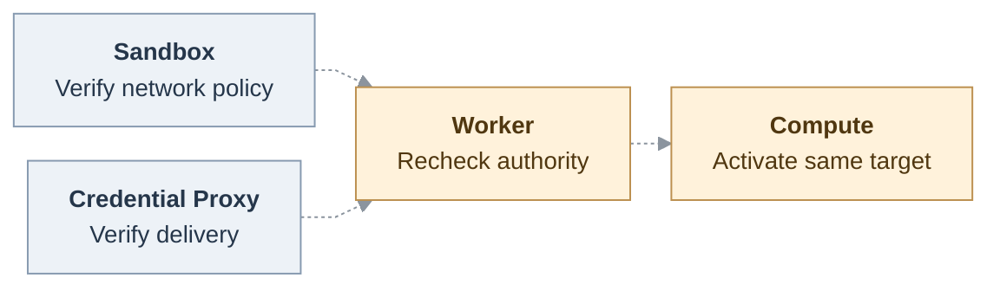

# Proposal: Sandbox and Proxy pairs

- **ID:** RFC-20261124-pluggable-sandbox-credential-delivery
- **Created:** 2026-11-24
- **Last updated:** 2026-11-24
- **Related:** [RFC-0023: Credential Proxy and credential lifecycle](0023-egress-proxy-credential-lifecycle/index.md)

## Summary

Extend RFC-0023 so an administrator can deploy a saved Agent with an external Sandbox and Credential Proxy. Require the pair to prove it can enforce the saved policy and deliver credentials outside the workload. The [Strands proposal](https://github.com/openclaw/openclaw-enterprise/pull/6505) owns Box-specific launch and policy translation. Ship sandbox support independently, then protected OpenAI Responses, then finite GitHub grants.

## Motivation

The [current credential path](../../docs/reference/credential-sources.md#implementation-status) supports first deployment of an explicit OpenAI Responses model through the paired OpenShell Sandbox and Proxy. Credential updates commit through TokenService and notify the Proxy. Runtime qualification and same-Harness rotation remain open.

| Gap exposed by a second provider                                                                                                                                                    | Change in the owning layer                                                                     |
| ----------------------------------------------------------------------------------------------------------------------------------------------------------------------------------- | ---------------------------------------------------------------------------------------------- |
| The [external loader](../../apps/controller/src/composition/driver-packages.ts) requires a legacy proxy even for staged delivery.                                                   | Select the paired delivery capability with OCC TokenService. Keep one lifecycle owner.         |
| [Admission](../../apps/controller/src/composition/openshell-credential-admission.ts) recognizes OpenShell classes. Model rules require an executable.                               | Check policy support on the selected pair. Require explicit whole-Agent grants for Box.        |
| [Kubernetes Compute](../../apps/controller/src/drivers/compute/kubernetes/index.ts) knows provider-specific workspace and startup details.                                          | Move those details to Sandbox. Keep enrollment, placement verification and release in Compute. |
| [Refresh](../../apps/controller/src/composition/token-service.ts) and [retirement](../../apps/controller/src/composition/installation-config.ts) require OpenShell-specific wiring. | Bind both operations to the recorded pair and verified placement.                              |
| Staged model admission (v8) and native repository admission (v9) cannot serve the same revision.                                                                                    | Version the combined staged policy and retain both readers.                                    |

## Proposal

Retain one installed package and configuration owner for both views. Require `credential_proxy` only when legacy serving is selected. A delivery-only package supplies `sandbox` and `credential_proxy_delivery`. Registration alone cannot authorize deployment. Before queueing deployment, the control plane (OCC) asks the pair to compile the full network and injection policies. Refuse missing capabilities, ambiguous grants or unenforceable routing, subject or presentation rules. A provider name grants no exemption.

Follow [staged startup](0023-egress-proxy-credential-lifecycle/installation-credential-ownership.md). Compute provisions an idle target through Sandbox. Worker authorizes the deploying actor and Agent and supplies a Source-scoped resolver. Proxy requires fresh, authenticated proof of the target incarnation before using the resolver, installs or attaches the credential and confirms the version on every serving copy. Sandbox reports the applied network policy.

The dashed arrows show proposed activation prerequisites. After both checks, Compute prepares fresh launch inputs with placeholders. Worker rechecks authority before Compute alone authorizes Sandbox to start the Harness on that execution and policy. Stale or unknown results hold startup. Reconcile lost acknowledgments before retrying.

Sandbox prevents bypass. The trusted Proxy authenticates the execution independently of its placeholder and checks the operation and required presentation on each request. Injection adds no network access. For whole-Agent Responses access, any process can use the granted operation, including provider-side tools the key permits. Only the trusted sender adds the key to the provider’s HTTPS request. Keep reusable secrets out of every Agent process, inference input, transcript, tool result and log.

On refresh, [TokenService](0023-egress-proxy-credential-lifecycle/credential-source-ownership.md) commits the version and notifies Proxy. Replace the concrete class check with verified placement. Compute resolves the Source’s Namespace. An absent delivery resource needs no credential and creates nothing. Proxy verifies each target there before resolution and acknowledges delivery only after readback. A failed notification leaves the committed version intact and delivery unconfirmed. On retirement, confirm removal of the exact owner’s copies before completing cleanup. An unavailable or changed owner cannot attest removal.

For finite GitHub access, follow [RFC-0023's shared-token policy](0023-egress-proxy-credential-lifecycle/github-app-template-policy.md). OCC applies repository ceilings and saves each Agent's effective repository, operation, ref, and expiry grants. TokenService owns issuance and renewal of the shared installation token. Proxy enforces the grants and expiry locally. Saving an ACL changes desired state. An acknowledged withdrawal blocks new requests, including requests on existing connections, and fences stale installs while peers retain their grants and the shared token remains valid. Shared-token PR creation stays disabled until head and base checks prevent use of an ungranted fork.

## Interface changes

### APIs

[Model admission](../../packages/occ/src/agent-deployment-admission.ts) copies a required executable path into the injection rule. Extend saved grants with an explicit whole-Agent subject for pairs unable to identify executables. OCC must authorize and save that scope separately for network access and credential use. Preserve existing executable rules. Refuse mixed or unsupported subjects before provisioning.

### IAM

No changes. Retain separate network, credential, Source and repository permissions.

### Database entities

Version saved policies and execution admission for new subjects. Bind delivery records to the pair, target incarnation, policy and credential versions, and cleanup owner. Specify a separate staged version and durable withdrawal generation for combined model and Git grants. Retain old readers, Gateway, Refresh and native Git cleanup until their consumers drain.

### Driver contracts

Expose policy compilation and verified placement through the paired Drivers. [Sandbox](../../packages/contracts/src/drivers/sandbox/index.ts) supplies workspace inspection and staged startup. [Proxy](../../packages/contracts/src/drivers/credential-proxy/index.ts) verifies recipients, reports serving copies and removes delivery from the recorded target. Compute retains enrollment and activation.

## Simplifications

Keeping only the bundled pair excludes external implementations. Reuse staged methods and remove shared provider checks. Sandbox-only deployments need no delivery capability.

## Acceptance Criteria

- **AC-1** Deploy a saved Agent with an external Sandbox alone. On the installed network, reach the admitted destination. Deny an ungranted destination and direct bypass.
- **AC-2** Cold-start a saved Agent without restarting Worker. Obtain a fresh hosted Responses reply. Refuse executable rules on an Agent-wide pair before provisioning. Block stale policy or material, replacement targets, plaintext, wrong paths and invalid required placeholders. Check PostgreSQL integration, installed ARM Helm, provider requests and workload scans.
- **AC-3** Update a running Agent’s Source through the API. Confirm every copy before reporting delivery. Delay an older update and lose an acknowledgment. Verify a late write cannot restore the old version. Retry retirement after an uncertain acknowledgment and confirm unrelated copies survive.
- **AC-4** Give two Agents different grants on one finite installation token. Test read and push discovery, repository, ref, expiry and renewal. Withdraw one grant while the token remains valid. Deny a fresh push, verify the remote branch is unchanged and confirm peer access and same-session model chat.

## Delivery

Start with package loading and three independent Strands repairs.

1. Recheck ownership before adopting a concurrent create. Refuse widened ingress or egress during DNS refresh.
2. Report only the pinned Pod as running. Refuse terminal Pods at first pin and keep ambiguous observations unknown.
3. Reclaim stalled TLS and readiness sockets without interrupting established sessions.

Qualify sandbox isolation on a supported Box receiver build. Follow with protected Responses and Source lifecycle, then finite Git. Installed acceptance remains open.
