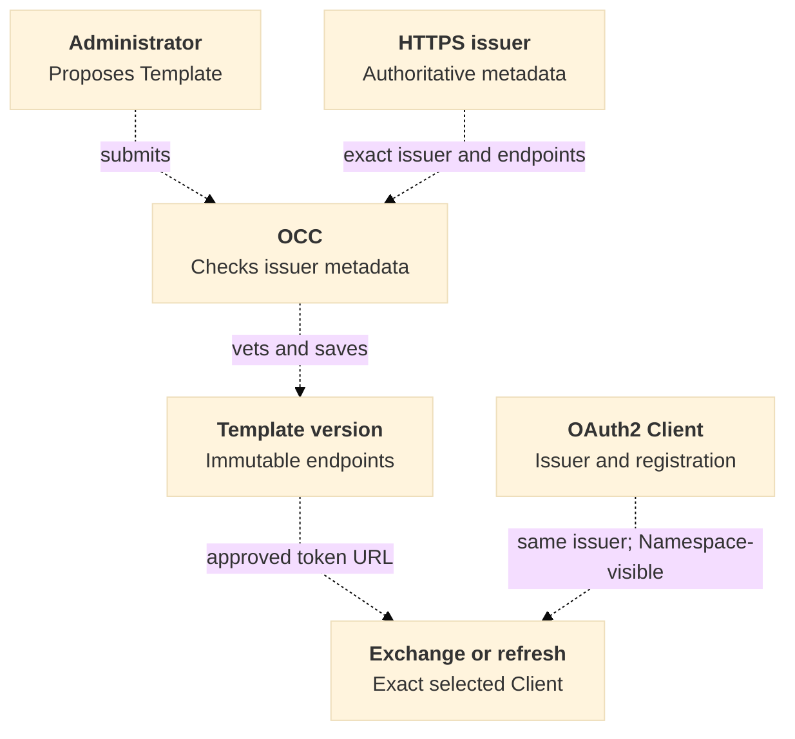

# OAuth endpoint authority in Credential Design 1.0

- **ID:** RFC-20261125-oauth-endpoint-authority
- **Created:** 2026-11-25
- **Last updated:** 2026-11-25
- **Related:** [Credential Design 1.0](20261124-credential-design-1-0.md), [OAuth client selection and consent](0023-egress-proxy-credential-lifecycle/oauth-client-associations.md)

## Summary

An OAuth2 CredentialClient identifies an issuer and a client registration. Its Connection Template version owns the authorization, token, and optional revocation URLs. Before saving an approved OAuth Template version, OCC authenticates metadata published by that exact issuer and verifies the endpoints. Exchange and refresh use the verified immutable version and the exact client selected at consent. This replaces the duplicated Client endpoint binding in the related RFCs.

## Motivation

Today administrators must enter the same token URL on a Client and its Template. That comparison also prevents a malicious Template from claiming a trusted issuer while directing an Installation client's secret to another server. Removing the Client field without replacing this protection would expose confidential clients and authorization codes.

Issuer and endpoint origins cannot be required to match. [Slack MCP's issuer metadata](https://mcp.slack.com/.well-known/oauth-authorization-server) advertises a token endpoint on `slack.com`; [Google's metadata](https://accounts.google.com/.well-known/openid-configuration) advertises one on `oauth2.googleapis.com`.

## Proposal

The following flow is proposed. A successful metadata check is a prerequisite to saving an approved OAuth Template version.

After authorizing `installation:administer`, OCC derives discovery URLs only from the exact issuer the administrator entered for the Template, using [RFC 8414](https://www.rfc-editor.org/rfc/rfc8414.html#section-3) or [OpenID Connect Discovery](https://openid.net/specs/openid-connect-discovery-1_0.html#ProviderConfigValidation). Their well-known URL rules differ for issuers with paths. OCC fetches metadata over authenticated HTTPS without credentials, refuses redirects, and requires the returned `issuer` to equal the proposed issuer exactly. The Template's authorization and token URLs must equal the advertised endpoints exactly. If the Template supplies a revocation URL, it must also be advertised and match exactly. A missing revocation endpoint does not prevent a Template without revocation from working. Retain the issuer's supported token authentication methods with the version, using the specification's default when metadata omits them. Endpoint verification does not limit manual Template scopes to OIDC `scopes_supported`; Google Workspace API scopes are not all listed there. Existing MCP resource and scope checks remain in force.

For manual Templates, OCC verifies the entered endpoints. MCP discovery continues to verify that the protected resource advertises the selected issuer before using its metadata. Neither a Template's declared issuer nor a shared hostname proves endpoint ownership. Invalid, missing, or unavailable metadata prevents approval; OCC sends no code, grant, or client secret. An issuer without authoritative metadata cannot use an OAuth Template under this proposal.

OCC persists the validation result with the immutable Template version. Existing unverified versions cannot become verified merely through a database migration. At consent, callback, and refresh, OCC requires that verified version, the exact matching Client issuer, an eligible authentication method, the correct destination Namespace, and the selected TokenService. Before each code exchange or refresh, OCC fetches the issuer metadata again and requires the saved token URL to remain advertised exactly. If metadata is unavailable or the endpoint changed, OCC refuses the request and retries or requires administrator action; it never retargets the Source. It resolves confidential material only after those checks. Requests send credentials only to that version's token URL, verify TLS, and do not follow redirects. MCP token requests also recheck that addresses are public and pin them for each request; manual requests use only the administrator-vetted exact endpoint, including approved private destinations. A new Template version cannot retarget an existing Source. Rotation changes the current secret of the saved Client without changing the Source's selected Client or Template version.

MCP discovery retains its existing public-address-only transport. Manual Template administration already lets the Installation administrator approve private HTTPS issuer and token URLs. For manual issuer discovery, OCC reuses that exact authority: only the administrator-approved issuer can supply the standard well-known URL, including for a private Keycloak realm. Authenticate TLS with the operator's trusted CA, pin resolved addresses for each request, refuse redirects, and limit metadata size and duration. Namespace consent callers cannot supply or discover arbitrary private issuers. Callback and refresh can revalidate only the issuer and endpoint saved in the administrator-vetted immutable version. Do not broaden MCP discovery. A Template can still be approved before any Client exists; consent separately requires an exactly matching registered Client. Bootstrap may seed the Google starter as unverified without a network request. An administrator must verify it through Template update before consent, and the Console displays that state.

Client registration remains independent of Templates and supplies `issuer`, `clientId`, and `tokenEndpointAuthMethod`, plus write-only material for confidential clients. One Client can serve several verified Templates for that issuer, and one Template can serve several eligible Clients. The Console selects the first eligible client in its dropdown and submits its exact ID. OCC rejects missing or incompatible selections.

## Interface changes

### APIs

- `POST /credential-clients` and Client reads remove OAuth `tokenUrl` and `revocationUrl`; retain issuer, optional `namespaceId` (Installation-wide when omitted), client ID, authentication method, and write-only secret rotation. GitHub App Client fields do not change.
- OAuth Template create/update validates issuer metadata before saving an approved version; version reads expose whether it is verified. Consent, eligibility, callback, and Source refresh use the verified version. Static Templates and built-in OAuth flows without a registered Client are unaffected.

### IAM

No changes. Installation administration controls Template and Client management. Consent requires `credential_source:create` in the destination Namespace; both resources must be visible there.

### Database entities

`oauth_clients` drops its endpoint columns and corresponding constraints. Template versions keep their endpoints and record successful issuer validation. Saved consent retains its exact Client and Template version, with typed references and Namespace enforcement. Unverified historical versions remain unusable. Because existing Sources pin those versions, affected WIP Sources must be retired and reconnected after the administrator approves a new version; creating a version alone cannot repair them.

### Driver contracts

Change the OAuth arm of `CredentialClientSecretInstance` from `tokenUrl` to `issuer` for registration, update, resolution, and removal. TokenService must enforce the exact Client ID, issuer, owner, purpose, scope, and selected instance. OCC validates the Template endpoint before resolving or sending the secret. GitHub App signing-key identity and custody do not change. The OCC private Secret address currently includes the token URL; changing it requires affected WIP Sources and confidential Clients to be retired and their old private material removed while the old token-URL address is still available, before the endpoint column is dropped. Administrators then re-register Clients and reconnect Sources. Preservation of existing WIP credentials is outside this proposal.

## Simplifications

Remove Client endpoint fields from SQL, API, Console, eligibility, and Driver custody. Keep the independent Client and immutable Template as the two existing owners; do not add a Client-to-Template table, issuer registry, stored default, or manual trust bypass. Retaining Client endpoints would avoid the new verification requirement but keep redundant configuration and restrict reuse.

## Acceptance Criteria

- **AC-1:** With Installation administration and Fastify/PostgreSQL, create two same-issuer Clients and two verified Templates. Discover both Clients for either Template; reject missing, foreign-Namespace, wrong-issuer, or incompatible selections. Client reads contain no endpoint or secret, and the Console submits its preselected ID. Verify a Google Workspace API scope not listed in Google OIDC metadata.
- **AC-2:** With a controlled HTTPS issuer, reject forged issuer metadata, mismatched or redirected targets, missing metadata, and unauthorized attempts to trigger private discovery before any credential or code is sent. Accept advertised cross-origin endpoints, an administrator-approved private issuer, and a verified Template created before its Client. Bootstrap remains available when Google is unreachable. Verify exact requests through the production API and TokenService.
- **AC-3:** With PostgreSQL and real disposable Keycloak, authorize the selected confidential Client, exchange the code, rotate its secret, and refresh the Source through the original verified Template version and saved Client. Advancing the Template does not redirect refresh; changed or unavailable issuer metadata refuses refresh without sending credentials. Check the endpoint against actual Keycloak metadata, not a test alias.
- **AC-4:** Qualify Slack MCP and Google metadata against their real public documents. Controlled issuer tests establish exchange behavior; external Slack or Google authorization and Agent usability require separate real-account proof.

## Unsupported manual issuers

Classic Slack App OAuth and other manual issuers that do not publish authoritative metadata fail closed. A separately trusted exact endpoint attestation mechanism would require a new security decision; it is not part of this change. Slack MCP is a different issuer and does publish the required metadata.
