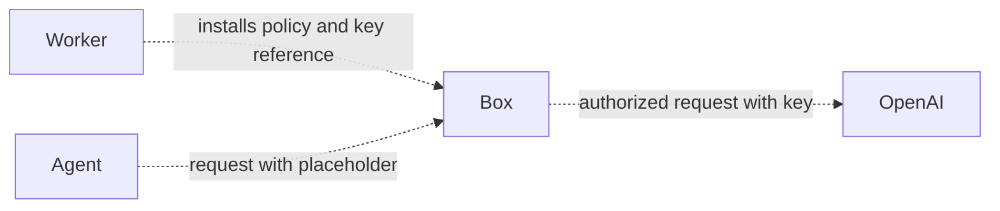

# Proposal: Run a dedicated Codex Agent on released Strands Box

- **ID:** RFC-20261125-stock-box-launch
- **Created:** 2026-11-25
- **Last updated:** 2026-11-25
- **RFC PR:** [#7370](https://github.com/openclaw/openclaw-enterprise/pull/7370)
- **Implementation:** [Dedicated key #7373](https://github.com/openclaw/openclaw-enterprise/pull/7373) · [Managed Source #7382](https://github.com/openclaw/openclaw-enterprise/pull/7382)
- **Related:** [Strands Box protected execution](https://github.com/openclaw/openclaw-enterprise/pull/6505) and [pluggable credential delivery](https://github.com/openclaw/openclaw-enterprise/pull/7209)

## Summary

Let an operator opt one Kubernetes tenant into the launcher shipped with Box 0.3.1.
A saved Agent can use a dedicated OpenAI key. Box holds the key and sends requests
directly to OpenAI. Every process in the Agent can use the approved route.

## Motivation

The [current driver](../../docs/reference/drivers/strands-box.md) requires a
[container receiver](https://github.com/strands-agents/box/pull/482) missing from
the release. The stock launcher starts its own child. Kubernetes Restricted
blocks the unmasked process filesystem the launcher needs to create that child's
private process view.

## Proposal

### Dedicated key

For a dedicated Codex Agent using API key login, set
`kubernetes.stockLauncher.namespace` to the exact Kubernetes tenant name in
the Strands Box Sandbox configuration. Use a dedicated installation. This
option enables the stock launcher and model route and refuses deployments
outside that tenant. Omit it to keep the current receiver and credential behavior.
For this tenant, the stock option replaces the separate preview flag proposed in
[#6948](https://github.com/openclaw/openclaw-enterprise/pull/6948). It applies only
to Agents with their own approved key and the reviewed endpoint. Reject aliases,
managed plugins, standalone search and additional credential grants.
Revoke any previously readable key and use a fresh one.

Only the trusted launcher receives the model key from the revision Secret.
The listener waits for the Worker to pin its certificate in an immutable
receipt. If the receipt is missing or belongs to a different Pod, Box cannot
start. A replacement's trusted launcher still receives the key. Revoke it at
the provider if access must end immediately. Box gives the workload a
fresh placeholder per execution and substitutes the key on HTTPS `POST api.openai.com/v1/responses`.
The workload chooses the body, including model and tools. Use a provider project
with appropriate permissions and spending limits. Reject unsupported credentials
and conflicting routes. Keep listener authentication and workspace access separate
from provider access. Refuse malformed or missing placeholders. End the child on supervisor loss
and require a fresh revision to resume. Hold deployment when retirement is
uncertain. Stop the old execution before rotating the static key.

### Managed Source

As a second increment, use the existing staged launch when the operator sets
`kubernetes.stockLauncher.agentGrants` on a dedicated installation. For
example, an entry `{ agentId, sourceId, profile: "openai-responses" }`
names a saved Agent and a static model Source. Each process in that Agent
may use the route. The installation must allow the endpoint. The deployer
and Agent still need Source permission. Refuse conflicting subjects and
unlisted Agents. This preview accepts exactly one grant. Never fall back to
a dedicated key.

Authenticate the idle Pod before resolving the approved Source. The trusted launcher
reports its fresh challenge, policy and credential version over the pinned
diagnostic channel. Worker rechecks the deployer and Agent before Compute
releases that launch. A replacement cannot reuse the release or request a
new copy. Its trusted launcher can mount the existing Secret until retirement.
To rotate, stop the execution, replace the key and redeploy. The delivery owner
must account for all remaining copies before reporting success. Preserve
peer bindings and leave withdrawal pending until retirement is confirmed.
Pending withdrawal of a required model blocks new OCC HTTP chats. An
already-running process may use the key until Stop.

### Kubernetes admission

Keep tenant labels Restricted. Only the approved Pod may select the
`oce-strands-box` RuntimeClass. The operator installs a cluster-wide validating
policy and deny binding before adding the class to the API server's Pod Security
exemptions. Remove the exemption first during teardown. A class exemption skips
all Pod Security checks, so the guard must enforce the remaining Restricted
controls, pin the namespace, image and launcher, and reject unapproved changes.
Require enforcement on updates and ephemeral containers. An absent binding
would remove this protection. Restrict policy editing and class selection to
trusted operators. Limit Pod creation, exec and debug access.

Only the Box container requests unmasked procfs. It uses private user and process
namespaces, enforced AppArmor and local seccomp. In the workload's private
mount namespace, Box covers sensitive procfs entries with empty mounts so
the workload and its children cannot inspect the underlying metadata.
Compare the result with an ordinary Restricted Pod on the same node.
Missing or unenforced profiles must prevent launch. Assume no harness sandbox.

## Interface changes

### APIs

No changes.

### IAM

No changes.

### Database entities

No new entities. The managed Source needs [migration 0097](https://github.com/openclaw/openclaw-enterprise/pull/7382)
to validate the Agent subject in saved policies. Existing executable rules
keep their meaning. Upgrade all readers before admitting the new subject.

### Driver contracts

Pin the launcher and credential mode to the revision. The dedicated-key
preview uses ordinary admission. Managed Sources use the paired Sandbox and
delivery Driver from #7209, with [explicit Agent subjects](https://github.com/openclaw/openclaw-enterprise/pull/7382)
for network and credential injection. Reject executable grants in both modes.
Provider traffic stays inside Box’s existing egress path.

## Simplifications

Reuse Box's existing placeholder and HTTP policy in either mode. A model
relay would add a service to every request. The receiver remains available to
installations that cannot grant a narrow launch exception.

## Acceptance Criteria

On an isolated ARM64 Helm installation, the operator configures one tenant
and the user deploys a saved Agent. Each goal requires runtime evidence.

- **AC-1 · Inference.** Complete a user turn through a saved Agent. Confirm the authorized request at
  the provider and verify that the child receives only the placeholder.
- **AC-2 · Isolation.** Test denial on unapproved routes. Compare sensitive paths in a workload and
  its child with a Restricted Pod on the same node. Check enforced profiles,
  process isolation and loss of supervision.
- **AC-3 · Admission and retirement.** Reject unauthorized use of the class and other departures from Restricted.
  Verify that stopping the Agent removes its route and that receiver defaults
  are unchanged.
- **AC-4 · Managed Source.** Refuse an unapproved Agent, Source or route.
  Exercise held launch, replacement, rotation and withdrawal. Refuse stale
  versions and confirm that retirement removes the execution and its copy.

## Delivery and verification

In [#7373](https://github.com/openclaw/openclaw-enterprise/pull/7373), a saved
Agent with a dedicated key answered through a controlled TLS origin while the Worker was stopped.
A replacement could not start Box. The operator must qualify each node image
and separately verify live provider access.

In [#7382](https://github.com/openclaw/openclaw-enterprise/pull/7382), a
saved Agent used a managed Source, stopped, then answered two more turns
with a replacement key. Withdrawal denied new HTTP chat and Stop removed
the copy. Stale release and replacement checks used simulated Kubernetes
objects. Both installed trials used a controlled provider.

Qualify this preview independently of the broader #6505 proposal. Keep Git
disabled until OCE can deliver scoped installation tokens, verify credential
redaction and demonstrate a push after renewal on the same Agent.
[Box #703](https://github.com/strands-agents/box/pull/703) proposes renewal.
