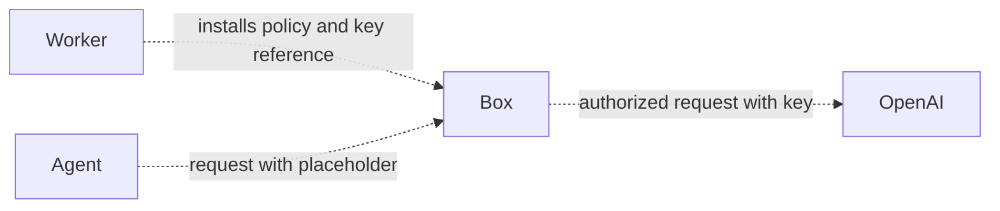

# Proposal: Run a dedicated Codex Agent on released Strands Box

- **ID:** RFC-20261125-stock-box-launch
- **Created:** 2026-11-25
- **Last updated:** 2026-11-25
- **Related:** [Strands Box protected execution](https://github.com/openclaw/openclaw-enterprise/pull/6505) and [pluggable credential delivery](https://github.com/openclaw/openclaw-enterprise/pull/7209)

## Summary

Let an operator opt one Kubernetes tenant into the launcher shipped with Box 0.3.1.
A saved Agent can use a dedicated OpenAI key. Box holds the key and sends requests
directly to OpenAI. Every process in the Agent can use the approved route.

## Motivation

The [current driver](../../docs/reference/drivers/strands-box.md) requires a
[container receiver](https://github.com/strands-agents/box/pull/482) missing from
the release. The stock launcher starts its own child. Kubernetes Restricted
blocks the unmasked process filesystem the launcher needs to create that child's
private process view.

## Proposal

For a dedicated Codex Agent using API key login, set
`kubernetes.stockLauncher.namespace` to the exact Kubernetes tenant name in
the Strands Box Sandbox configuration. This opts into both the stock launcher
and the model route. Omit it to keep the current receiver and credential behavior.
For this tenant, the stock option replaces the separate preview flag proposed in
[#6948](https://github.com/openclaw/openclaw-enterprise/pull/6948). It applies only
to Agents with their own approved key and the reviewed endpoint. Reject aliases,
managed plugins, standalone search and additional credential grants.
Revoke any previously readable key and use a fresh one.

The trusted launcher alone receives the Secret. Box gives the workload a
fresh placeholder per execution and substitutes the key on HTTPS `POST api.openai.com/v1/responses`.
The workload chooses the body, including model and tools. Use a provider project
with appropriate permissions and spending limits. Reject unsupported credentials
and conflicting routes. Keep listener authentication and workspace access separate
from provider access. Refuse malformed or missing placeholders. End the child on supervisor loss
and require a fresh revision to resume. Hold deployment when retirement is
uncertain. Stop the old execution before rotating the static key.

### Kubernetes admission

Keep tenant labels Restricted. Only the approved Pod may select the
`oce-strands-box` RuntimeClass. The operator installs a cluster-wide validating
policy and deny binding before adding the class to the API server's Pod Security
exemptions. Remove the exemption first during teardown. A class exemption skips
all Pod Security checks, so the guard must enforce the remaining Restricted
controls, pin the namespace, image and launcher, and reject unapproved changes.
Require enforcement on updates and ephemeral containers. An absent binding
would remove this protection. Restrict policy editing and class selection to
trusted operators. Limit Pod creation, exec and debug access.

Only the Box container requests unmasked procfs. It uses private user and process
namespaces, enforced AppArmor and local seccomp. Box starts the workload in its
own process and network namespaces. Require the workload and its children to
retain the sensitive-path restrictions of an ordinary Pod on that node.
Missing or unenforced profiles must prevent launch. Assume no harness sandbox.

## Interface changes

### APIs

No changes.

### IAM

No changes.

### Database entities

No changes.

### Driver contracts

Add the optional stock launcher configuration above. Reuse the prepared
dedicated key and existing revision lifecycle. This mode cannot satisfy
executable-specific grants or staged credential delivery. Reject them.

## Simplifications

Keep one opt-in and use Box's existing placeholder and HTTP policy. A model
relay would add a service to every request. The receiver remains available to
installations that cannot grant a narrow launch exception.

## Acceptance Criteria

On an isolated ARM64 Helm installation, the operator configures one tenant
and the user deploys a saved Agent. All three goals require runtime evidence.

- **AC-1 · Inference.** Complete a user turn through a saved Agent. Confirm the authorized request at
  the provider and verify that the child receives only the placeholder.
- **AC-2 · Isolation.** Test denial on unapproved routes. Compare sensitive paths in a workload and
  its child with a Restricted Pod on the same node. Check enforced profiles,
  process isolation and loss of supervision.
- **AC-3 · Admission and retirement.** Reject unauthorized use of the class and other departures from Restricted.
  Verify that stopping the Agent removes its route and that receiver defaults
  are unchanged.

## Delivery and verification

Qualify this preview independently of the broader #6505 proposal. Keep Git
disabled until OCE can deliver scoped installation tokens, verify credential
redaction and demonstrate a push after renewal on the same Agent.
[Box #703](https://github.com/strands-agents/box/pull/703) proposes renewal.
