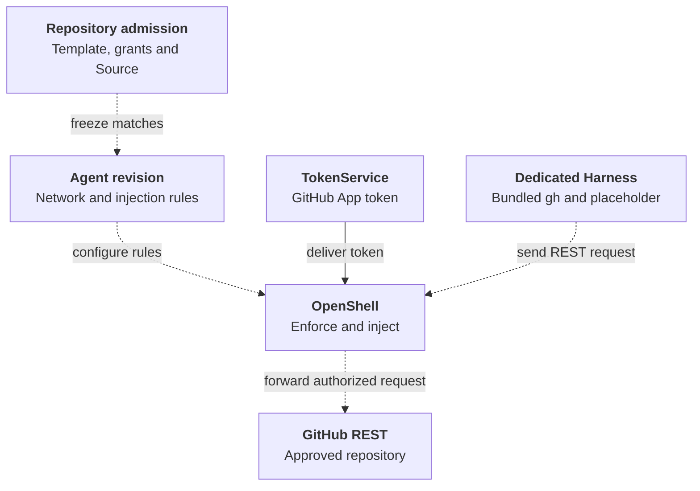

# Built-in GitHub Connection Template for Repository REST

- **ID:** RFC-20261126-github-connection-template
- **Created:** 2026-11-26
- **Last updated:** 2026-11-26
- **Related:** [Credential Design 1.0](20261124-credential-design-1-0/index.md), [Native PR publication](20261126-native-github-pr-publication.md), [C6 implementation](https://github.com/openclaw/openclaw-enterprise/pull/7480)

## Summary

Let a Dedicated Agent read any GitHub pull request (PR) in an approved repository through its existing GitHub App Source. The OpenClaw Control Plane (OCC) automatically associates a built-in GitHub Connection Template when it admits the Repository binding. The Template defines the reviewed endpoints. The existing Agent grant, Namespace permissions and verified Source scope determine which of them the Agent can use. An Agent that opens a draft can then read back its number, URL and draft status.

## Current behavior

On main, Dedicated Agents can use the shared `github-app-installation` Source for native Git. OCC can separately allow credential-free metadata requests for selected repositories. [C6](https://github.com/openclaw/openclaw-enterprise/pull/7480) proposes one authenticated REST request from `/usr/local/bin/gh` to `api.github.com:443`, an exact `POST /repos/{owner}/{repo}/pulls`. Its admission, Proxy validation, database constraint and skill selection depend on that one operation. The proposed readback uses the PR number returned by GitHub. It can also read an existing PR without granting push or publication.

[Connection Templates](../../docs/reference/connection-templates.md) describe static Bearer or OAuth/MCP destinations today. Static rules support a method and an exact path or terminal subtree. A `/pulls/**` subtree would also admit PR comments, reviews and other subresources for the allowed method. The shared GitHub App Source has its own client and finite installation scope. Hosted Plugin account admission continues to use its own Template ID and version.

## Proposal

### Catalog and admission

Ship one immutable, versioned GitHub Template in the Repository policy catalog. For a new deployment, OCC selects the built-in version for the Repository consumer with a verified `github-app-installation` Source and saves that exact Template ID and version once on the Agent revision’s Repository binding. The Source retains its current client, installation, repository IDs and token permissions. Source enrollment and renewal continue to use that identity. Operators set authority through the existing Repository grant and Namespace registry.

OCC checks that the deployer and Agent can operate the exact Source. For each saved Agent grant, Repository admission resolves the repository against the finite Source by verified ID and canonical name. It admits PR readback when the Agent has Repository Read or Write, the Namespace grants effective PR Read or Write, the Source has verified PR Read or Write, and the selected Sandbox and Credential Proxy can enforce the rule. Evaluate Namespace `apiLimits.pull_requests` before `apiLimits.default`. When neither applies, use the registered `permissions.pull_requests`. An explicit PR limit of `none` or an applicable `default: none` denies readback. A ceiling can only narrow the registered permission.

This changes what an existing Read or Write grant can do on its next deployment. For example, a Namespace that registered PR Write for publication and left `apiLimits` unset would also authorize readback for an eligible Agent after a new deployment. A serving revision keeps its saved rules through renewal. Review this inheritance because the Agent editor currently labels these choices Read-only Git and Read/write Git. Before enabling readback, update the editor’s labels and help to explain when a Repository grant also permits PR reads. Keep the same grant selection. The catalog keeps the exact C6 publication rule and its full Source coverage check. Git discovery and pack requests keep their existing transport policy.

OCC freezes the compiled matches in the separate network and injection policies. Before activation or reconfiguration, the Worker revalidates the saved routes against the pinned Template and current authority. For revisions deployed before the Template, the Worker continues to revalidate the saved Git and C6 rules against current authority. A new catalog version can add routes only through a new deployment. If the runtime cannot enforce a saved rule, activation fails. Use Stop or binding withdrawal to remove a loaded route.

The Gateway uses the saved Repository injection policy to show each Harness the relevant commands in the existing managed GitHub skill. A read-only Agent gets the read command. The skill uses the current placeholder and GitHub CLI and reports a denied request without changing credentials.

The dashed connections show the proposed REST path.

### Endpoint rules

At admission, bind the PR read operation to `{owner}` and `{repo}` from GitHub’s verified repository name. The Agent supplies `{number}` with each request, so the same rule covers any valid PR number in that repository, including PRs GitHub creates after deployment. Match one positive decimal segment of 1 to 19 digits without a leading zero. Match and forward the same canonical path. Reject encoded separators, ambiguous targets and canonical paths with extra segments. The historical [OpenShell rule compiler](../../apps/controller/src/drivers/sandbox/openshell-git-network-policy.ts) shows how to express a numeric segment using fixed-width decimal globs. The proposal includes HEAD on the same path and authority because OpenShell treats HEAD as a GET match. Each redirected request needs its own network and injection decision. Reject overlapping Sandbox or credential rules that would bypass these checks. [Pinned OpenShell REST matcher](https://github.com/ai-openshell/openshell/blob/ce58cf8e9b953281352d98a637e41616295b1318/crates/openshell-supervisor-network/data/sandbox-policy.rego#L761-L817).

If a repository name is reused, GitHub can resolve the saved path directly to a different repository covered by the same Source token. Require PR reads to remain bound to the admitted GitHub repository ID for the life of the route. Before enabling readback, show that GitHub enforces that ID for the request or that the old route becomes unavailable before its name can resolve to a different ID. Scope checks at admission and renewal alone leave a serving window. Keep readback unavailable wherever this boundary is unproven. [GitHub repository renames](https://docs.github.com/en/repositories/creating-and-managing-repositories/renaming-a-repository).

| Operation            | Match on `api.github.com:443`                              | Effective authority                                                                                                                                                                 |
| -------------------- | ---------------------------------------------------------- | ----------------------------------------------------------------------------------------------------------------------------------------------------------------------------------- |
| Read a PR            | `GET` and `HEAD` on `/repos/{owner}/{repo}/pulls/{number}` | Saved Agent Read or Write, effective Namespace PR Read or Write, and verified Source PR Read or Write. GitHub may accept Contents Read for this request. OCE requires PR authority. |
| Open PR, if C6 lands | Exact `POST /repos/{owner}/{repo}/pulls`                   | C6’s existing target Write, Namespace and Source PR Write, and Read or Write across the Source’s complete verified repository scope.                                                |

The new GET authorizes the GitHub endpoint’s documented representations, including diff and patch. HEAD checks the same resource without a response body. Test whether the shared credential exposes any additional data from an ungranted private head repository compared with a token scoped to the approved base repository. Treat a difference in private data as a release blocker requiring a narrower operation or grant. The endpoint documents no query-based repository selector. This proposal adds no general query, header or JSON policy syntax. A future rule that carries resource identity in a query or body needs a matcher for the exact field and canonical value, plus rejection of ambiguous or duplicate values. For example, a PR POST can carry `head` and `head_repo` in the body, so C6’s full-Source coverage check remains necessary. [GitHub PR endpoint contract](https://docs.github.com/en/rest/pulls/pulls#get-a-pull-request). [C6’s fork-head evidence](https://github.com/openclaw/openclaw-enterprise/pull/7135).

The new route requires HTTPS on the Harness hop, verified upstream TLS, and enforcement based on the executable that opens the socket. Use released OpenShell support and verify the selected Gateway and Supervisor can enforce all three before admitting the read. A policy-loaded receipt alone is insufficient. A new deployment without proven support uses its otherwise eligible Git and C6 rules. A deployment that already saved a read rule fails activation if that support is unavailable. C6’s temporary plaintext and descendant allowances apply to its exact publication match. Qualify the read on the same running revision as publication before enabling both together. [OpenShell socket-owner issue](https://github.com/ai-openshell/openshell/issues/4943).

### Scope beyond the first version

- **Read an issue by number.** The [PAT-backed proposal](https://github.com/openclaw/openclaw-enterprise/pull/7243) describes an Agent reading issue 42, fixing it and opening a PR. That is a concrete follow-up for the GitHub App path. GitHub’s issue endpoint can return a PR’s issue representation and can redirect a transferred issue. Review the permission for that representation and verify that each redirected request requires its own admission. [GitHub issue endpoint contract](https://docs.github.com/en/rest/issues/issues#get-an-issue).
- **List PRs or issues, and create issues.** The [earlier repository RFC](20261123-repository-issue-creation.md) covers these use cases for the old delivery path. A list rule must account for supported filters, pagination and the issue API’s inclusion of PRs. Issue creation can link a parent issue by ID in another repository. It needs a decision and enforcement for that body field before using a shared Source. [GitHub PR list](https://docs.github.com/en/rest/pulls/pulls#list-pull-requests). [GitHub issue creation](https://docs.github.com/en/rest/issues/issues#create-an-issue).
- **Full `gh pr create`.** Stock `gh` uses GraphQL preflights and a mutation on `POST /graphql`. A method and path allowlist cannot identify the repository in that request. This requires trusted repository node-ID mapping and enforced argument, input and nested-field rules covering the real requests. [Pinned GitHub CLI source](https://github.com/cli/cli/blob/v2.103.2/api/queries_pr.go#L490-L520). [OpenShell GraphQL work](https://github.com/ai-openshell/openshell/pull/5996).
- **Uploads, search and account endpoints.** The `gh pr create --attach` command can write to `uploads.github.com/user-attachments/assets` before creating the PR. That operation selects the repository via a numeric query parameter and sends a binary body. Search and installation-wide inventory also lack a repository in the path. These operations remain unavailable through this Template version. [Pinned GitHub CLI attachment client](https://github.com/cli/cli/blob/v2.103.2/internal/attachments/client.go#L105-L134).

## Interface changes

- **API and configuration.** Reuse the current Agent Repository selection and Namespace registry. OCC selects the built-in Template during admission.
- **IAM.** Reuse Installation administration for registration and the existing Agent deployment, Repository and exact Source checks.
- **Database.** Record the exact Template ID and version once per saved Repository binding. Validate the matcher’s structure and its relation to a canonical granted repository, fixed host, port and executable, with an identical network match for each injection match. The single catalog owns the operation and permission checks at admission and Worker revalidation.
- **Driver contracts.** Review the Repo policy compiler output and new path constraint consumed by Sandbox and Credential Proxy, including matcher validation and overlap checks. Require that a selected pair enforce the new route before it reports readiness. TokenService continues to issue and deliver the same finite token.

## Delivery and verification

1. Submit this RFC for human review. Approve the endpoint, inheritance on fresh deployment and required HTTPS and executable enforcement. Confirm or qualify the selected OpenShell capability before enabling the new route.
2. Once the design is approved, deliver the catalog, revision binding and request match with their generated contract if the schema diff is substantial. Stack the Agent admission, Proxy compilation and managed skill change on that PR. Build on C6 after it lands for the publication/readback flow. Check the existing Agent editor’s help against an eligible grant and a Git-only grant. Update the current [Connection Template reference](../../docs/reference/connection-templates.md) and [Repository credential flow](../../docs/flows/agent-repository-credentials.md) with the shipped behavior.
3. Extend the existing PostgreSQL Agent admission and installed shared-Source Agent tests. Deploy Read Agents sharing a finite Source for private repositories A and B. From a regular Agent turn, use stock `gh api --hostname github.com --method GET repos/OWNER/REPO/pulls/NUMBER` with the existing placeholder. Read one existing PR and one PR created after deployment in A from the same Agent revision. Confirm both results identify A and return the correct draft status. With only A granted, verify B, an unlisted method, a nonnumeric segment and a child path are denied before the origin. On a runtime that supports only the existing rules, verify a new deployment keeps eligible Git and C6 access and has no read route or read instructions. Exercise inherited Namespace permission, explicit PR denial and `default: none`. Verify a Source with PR Read can read a known PR and that a Git-only Source with Contents Read has no route to it. Deploy an eligible draft saved before rollout and confirm the new revision gains readback. Confirm an already serving revision keeps its routes through renewal, and a saved read rule fails activation when its required enforcement is unavailable. Verify push and PR creation retain their existing grants.
4. Qualify an authorized disposable GitHub App and repositories.

   - With a Source covering A and B and an Agent revision granted PR read only in A, first verify a PR read in A. Rename A and reuse its old name for B. Verify that the old name now resolves directly to B and the issued token still covers B. From the original Agent revision, try GET and HEAD on a known private PR in B through the old path. Confirm no access before renewal or redeployment.
   - On one eligible Write revision with both routes installed for A, use stock `gh` over HTTPS to open a draft with POST and then read that PR with GET and HEAD. On that same revision, verify GitHub receives neither read over plaintext or from a different socket-opening executable descended from `gh`. Verify GitHub receives no POST to the numbered path.
   - On a PR from private head B into base A, compare JSON, diff and patch results from the shared Source with a token scoped to A. Verify both Dedicated Harnesses use only the approved managed instructions and that Stop or binding withdrawal removes access for one Agent while a peer continues. On a denied or uncertain publication result, have the skill report the outcome without retrying the POST.

No qualification has run for this proposal.

## Alternatives and decisions for review

Exact collection paths fit the current method/path type. Staged Repository admission and its database validator would still need to accept them. The PR detail rule needs one reusable positive integer path segment matcher. Other reviewed operations, such as reading a specific issue, can use the same matcher. A configurable endpoint language would allow more expressions but would also let an administrator introduce effects the shared token can perform outside the addressed repository. Keep endpoint definitions built in and review each operation when adding it.

A separate Namespace Template selector would make rollout opt-in per repository. It would also leave operators with two controls for the same read operation. Use the existing Namespace PR ceiling and Agent Repository grant. If maintainers want readback to require an explicit Namespace decision, they can require a positive `apiLimits.pull_requests` entry for readback. That would use explicit values already in the registry. It would not ask operators to approve those grants again. The ceiling governs PR access as a whole, and `none` also withholds C6 creation.

Approve reading any PR in an authorized repository, including HEAD and the documented response formats, and confirm that effective PR Read can inherit the Namespace’s registered permission on fresh deployment. The route requires HTTPS and socket-opening executable enforcement.
