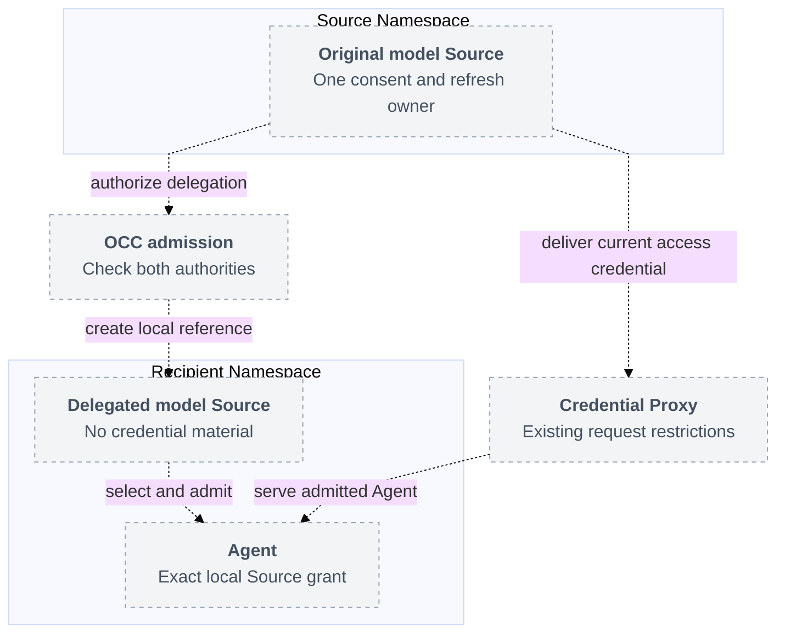

# Proposal: Delegate model credentials across namespaces

- **ID:** RFC-20261127-cross-namespace-model-credentials
- **Created:** 2026-11-27
- **Last updated:** 2026-11-27

## Summary

Let a credential owner authorize another Namespace to use a managed model
CredentialSource without copying its OAuth refresh token or repeating provider
consent. OpenClaw Control Plane (OCC) keeps one authoritative Source and one
renewal lifecycle. A recipient-local Source reference fits the existing Agent
selection workflow. Delegation is explicit, revocable, and limited to one
Installation. Placement on the same worker grants no credential access.

## Motivation

A provisioning service creates separate customer Namespaces and Agents. The
operator pays for model access and wants each authorized Agent to receive it
automatically. Today, [model Source bindings](../../docs/reference/credential-sources.md#bind-a-source-to-an-agent)
reuse a Source within its Namespace. Admission resolves both the caller's grant
and the Source against the Agent's Namespace in
[Harness authentication](../../packages/occ/src/harness-auth.ts) and
[Agent credential access](../../packages/occ/src/agent-credential-access.ts).
An authorized source ID from another Namespace is therefore insufficient.

[Shared model configuration](0028-shared-model-provider.md) and
[reusable model providers](0034-reusable-model-providers/index.md) address
endpoint selection, not cross-Namespace credential authority. This proposal
extends [Credential Design 1.0](20261124-credential-design-1-0/index.md) at that
boundary; it does not replace its custody or request enforcement.

## Goals and non-goals

- Use one eligible managed model Source from multiple authorized Namespaces.
- Keep credential custody, provider consent, and refresh at the original Source.
- Support ordinary Agent creation, deployment, rotation, withdrawal, and recovery.
- Keep same-Namespace bindings unchanged and cross-Namespace use denied by default.

This does not introduce a model router, external credential broker, token export,
automatic access for a host, or sharing between Installations. Plugin, repository,
Gateway startup, and arbitrary Secret delegation are outside the initial scope.
Provider eligibility and account permissions remain prerequisites; delegation
does not enlarge a provider grant or establish permission to resell access.

## Proposal

### Ownership and caller workflow

Extend CredentialSource with a recipient-local **delegated model Source**. It
contains no credential and refers to one original, supported model Source and
one durable delegation. Do not register it as another TokenService credential.
Delegated Sources cannot be delegated again or retargeted to another original.

An operator or provisioning service creates the delegation with explicit
authority on both sides: a new `credential_source:delegate` permission on the
original Source, and `credential_source:create` in the recipient Namespace.
Existing `operate` permission alone must not permit delegation. A provider's
credential owner or Installation policy can still prohibit sharing.

The recipient's normal Agent workflow selects its local Source ID in both
`harnessAuth` and `credentialSources`. Agent creation and deployment require
the existing recipient-local caller and Agent `operate` grants. OCC also checks
the original Source, the active delegation, and the approved model request
policy. Neither customer access nor a new Namespace implies these grants.
An authorized provisioner can establish them as part of its normal workflow;
no wildcard grant to future Namespaces or worker nodes is added.

### Architecture

All dashed connections below are proposed. Existing TokenService and Credential
Proxy remain the owners of credential custody and delivery.

### Renewal, denial, and cleanup

TokenService retains the original Source identity. Credential Proxy tracks each
admitted recipient binding against that identity. Refresh commits once, then
updates all still-authorized delivery copies. A failed recipient delivery is
retried without another consent, credential registration, or refresh-token copy.
The recipient cannot rotate, replace, disconnect, or delete the original.

Revocation records denial before asynchronous cleanup. Admission, activation,
delivery retries, and recovery recheck that denial, including for older running
revisions and in-flight deployment work. Extend the existing
[withdrawal lifecycle](../../docs/reference/credential-sources/withdrawal.md)
across delegated bindings. A confirmed control-plane denial is not proof that
an existing delivery copy is gone: report cleanup as pending until the selected
Proxy confirms withdrawal. Do not claim cancellation of an in-flight provider
request or stronger confinement than the selected delivery path provides.

The original owner can revoke one delegation; the recipient can withdraw one
Agent or remove its local Source without affecting other recipients. Source and
Namespace deletion account for incoming and outgoing delegations. Original
Source deletion retains existing conflict and cleanup semantics across all
recipients rather than leaving orphaned references. Missing authority or an
unavailable dependency never triggers another Source, provider, or namespace
fallback. Audit creation, use admission, denial, and revocation without tokens.

## Interface changes

The following interfaces are proposed, not existing API operations.

### APIs

- `POST /namespaces/:namespaceId/credential-sources/:sourceId/delegations`
  accepts a recipient Namespace ID, local display name, and idempotency key.
  It returns the delegation and recipient-local Source IDs, never credentials.
  Replays adopt the same result; a changed body under the same key conflicts.
- Owner-scoped list and exact revoke operations expose nonsecret delegation
  status. Revocation returns a durable pending/complete cleanup result.
- Recipient Source list/read and native Agent selection include eligible local
  references. They disclose no original account details without source-side read
  authority. Existing Source update/rotation APIs reject credential writes to
  delegated references; deletion withdraws local use, not the original grant.

### IAM

Add explicit `credential_source:delegate` on an original Source. Creation also
requires recipient Namespace Source-create authority. Keep existing exact
recipient Source and Agent permissions for use. Source owners can revoke their
delegations without recipient administration rights. IAM implementations that
cannot represent this authority must refuse the feature, not substitute broad
Installation or Namespace membership.

### Database entities

Add delegation state with original and recipient Namespace/Source identities,
creator, idempotency key/body digest, generation, denial, and cleanup status.
Persist the local Source reference and reverse indexes for rotation and
retirement. Atomically create the reference, delegation, and audit event.
Concurrent creation, revocation, Source deletion, and revision activation must
serialize against the same authoritative records. A revoked generation cannot
become valid through replay or a recreated Namespace with the same name.

### Driver contracts

TokenService continues to resolve and refresh the canonical Source, not the
recipient-local reference. Review Credential Proxy delivery and withdrawal
contracts for the distinction between credential owner and recipient Agent,
including fan-out receipts. Extend IAM contracts for explicit delegation.
Drivers must declare support before use; this RFC does not assume that accepting
the current interface establishes cross-Namespace qualification. No Compute
placement or provider endpoint-authority expansion is proposed.

## Simplifications

Putting every customer in one Namespace removes this change but does not retain
the required customer boundary. Repeated OAuth grants retain current behavior
but require human consent during otherwise automatic provisioning. Copying
refresh tokens introduces competing renewal owners. A separate model broker
duplicates existing credential delivery. Local references reuse Agent selection
and the existing TokenService/Proxy lifecycle without another top-level resource.

## Acceptance Criteria

- **AC-1 — Normal workflow:** With a real PostgreSQL store and qualified delivery
  Drivers, an owner-authorized provisioner creates recipient references in two
  Namespaces, then creates and deploys Agents through the normal API. Each
  completes a model/tool/result turn using one original credential registration.
- **AC-2 — Authority:** Requests lacking either creation permission fail before
  any reference or credential delivery. Recipient users cannot enumerate private
  original account data, retarget, redelegate, rotate, or disconnect the original.
  An undelegated Namespace or another Agent receives no access by sharing a node.
- **AC-3 — Refresh and recovery:** With a refresh-capable test issuer and real
  Proxy delivery, rotate the original while both recipients run. Prove one
  authoritative refresh, successful subsequent turns, and restart-safe recovery
  after an interrupted delivery without a second credential registration.
- **AC-4 — Revocation:** Revoke one delegation during pending deployment and
  rotation. Verify durable denial, withdrawal of its existing copies, rejection
  after restart/replay, and continued service to the original and other recipient.
  Separately withdraw one recipient Agent without disabling its peers.
- **AC-5 — Retirement and compatibility:** Exercise Source and both Namespace
  deletion paths, repeated create/revoke, and unsupported Drivers. Verify no
  orphaned access, default denial, attributable audit, and unchanged normal
  same-Namespace binding behavior.

## Delivery and verification

Submit this contract proposal before implementation. Maintainer review must
confirm Driver support and revocation guarantees. Implement through the normal
Agent workflow, with PostgreSQL integration and qualified live Proxy/Harness
proof mapped to AC-1 through AC-5. Add Console selection coverage if its behavior
changes. No product implementation, provider consent, deployment, or runtime
acceptance is included in this RFC-only PR.

## Open decisions

Maintainers must confirm whether a local delegated Source or an explicit
cross-Namespace binding best fits the resource model. Either design must retain
one credential owner, bilateral creation authority, exact Agent permissions, and
durable revocation. Provider eligibility and the supported Driver combinations
must be explicit before enabling the feature.
