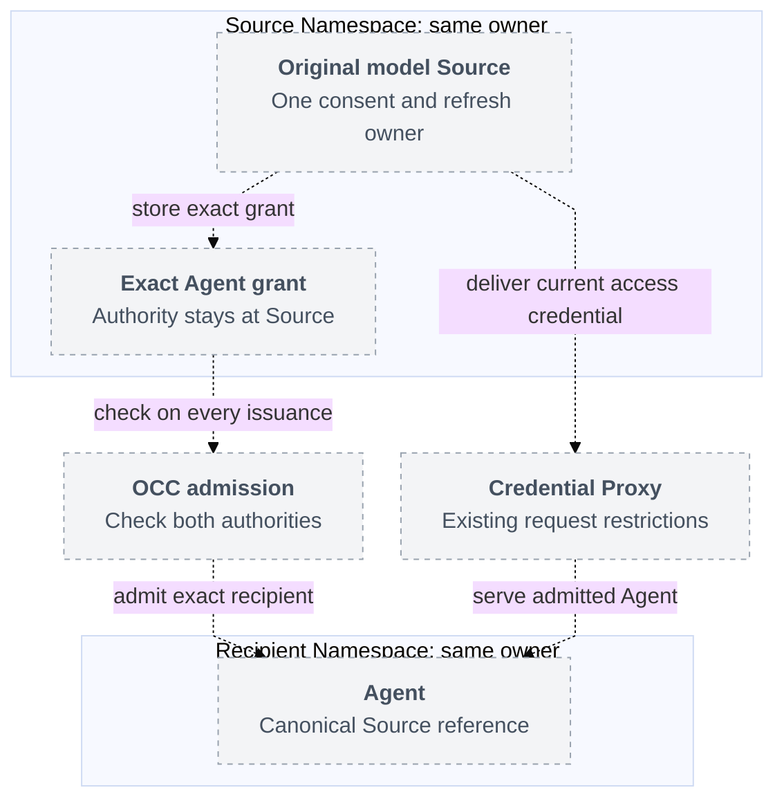

# Proposal: Delegate model credentials across namespaces

- **ID:** RFC-20261127-cross-namespace-model-credentials
- **Created:** 2026-11-27
- **Last updated:** 2026-11-27

## Summary

Let a credential owner grant one Agent in another Namespace access to an
existing model CredentialSource. Both Namespaces must belong to the same owner
and trust domain. Keep one Source, one OAuth renewal owner, and one source-side
grant per recipient Agent. Do not create a recipient-local Source or copy a
refresh token. Worker placement grants no access.

## Motivation and current code

An owner runs Agents in separate Namespaces and wants to reuse an existing
model authorization without another provider login. This proposal covers those
owner-operated Agents, not sharing a subscription between unrelated customers.
Provider permission to use a credential this way is a separate prerequisite;
this RFC does not establish that permission.

An IAM policy change alone cannot enable this in the current code:

- [Agent credential access](../../packages/occ/src/agent-credential-access.ts)
  authorizes and locks each Source in the Agent's exact Namespace.
- [Agent bindings](../../packages/contracts/src/index.ts) carry only `sourceId`;
  they cannot select an explicitly authorized Source in another Namespace.
- [TokenService resolution](../../packages/contracts/src/drivers/token-service/index.ts)
  receives a canonical Source reference, not a recipient Agent or grant. The
  [OCC Driver](../../apps/controller/src/drivers/token-service/occ.ts) resolves
  that Source's private storage and OAuth account. It cannot check a recipient
  grant that the caller does not provide.

Keep those boundaries until the connected path below exists. Do not remove an
exact-Namespace check or rewrite a stored Source's Namespace to bypass it.
[Credential Design 1.0](20261124-credential-design-1-0/index.md) still owns custody
and delivery; [shared provider configuration](0028-shared-model-provider.md)
does not confer credential authority.

## Goals and non-goals

- Use one eligible managed model Source from multiple authorized Namespaces.
- Keep credential custody, provider consent, and refresh at the original Source.
- Support ordinary Agent creation, deployment, rotation, withdrawal, and recovery.
- Keep same-Namespace bindings unchanged and cross-Namespace use denied by default.

This does not introduce a model router, external credential broker, token export,
automatic access for a host, or sharing between Installations. Plugin, repository,
Gateway startup, and arbitrary Secret delegation are outside the initial scope.
Provider eligibility and account permissions remain prerequisites; delegation
does not enlarge a provider grant or establish permission to resell access.

## Proposal

### Ownership and caller workflow

Store the authoritative grant with the original Source. It names exactly one
recipient Namespace, Agent identity, and generation. A recipient selects the
canonical Source through an explicit cross-Namespace reference. There is no
second Source registration, local alias, or transitive delegation.

Creation requires `credential_source:delegate` on the original Source and
recipient Agent administration authority. Existing `operate` grants alone do
not permit delegation. The owner must explicitly designate both Namespaces as
one owner-operated trust domain. Namespace names, shared infrastructure, or an
administrator who can manage unrelated tenants are not proof of common ownership.
The current Namespace model has no owner field; implementation must add an
authoritative owner-policy check through IAM, not infer ownership from names.
Unsupported IAM implementations deny cross-Namespace delegation.

Normal Agent creation and deployment still require recipient-local permissions.
OCC checks the grant and exact Agent identity during admission and deployment.
TokenService checks the active grant again whenever it issues an access token
for a recipient, including refresh delivery and retry. Cached authorization is
not sufficient. Unknown, revoked, stale, or unavailable authority fails closed.

Provisioning may create an exact grant only under an owner-approved policy for
that same trust domain. Buying a subscription or creating a Namespace does not
establish that policy. Sharing a model authorization across independent SaaS
customers is outside this RFC and is not automatically enabled.

### Architecture

All dashed connections below are proposed. Existing TokenService and Credential
Proxy remain the owners of credential custody and delivery.

### Renewal, denial, and cleanup

TokenService retains the original Source identity. Credential Proxy tracks each
admitted recipient binding against that identity. Refresh commits once, then
updates all still-authorized access-token delivery copies. Only TokenService
refreshes OAuth; recipients never receive the refresh token. A failed recipient delivery is
retried without another consent, credential registration, or refresh-token copy.
The recipient cannot rotate, replace, disconnect, or delete the original.

Revocation records denial before asynchronous cleanup. Admission, activation,
delivery retries, and recovery recheck that denial, including for older running
revisions and in-flight deployment work. Extend the existing
[withdrawal lifecycle](../../docs/reference/credential-sources/withdrawal.md)
across delegated bindings. A confirmed control-plane denial is not proof that
an existing delivery copy is gone: report cleanup as pending until the selected
Proxy confirms withdrawal. Do not claim cancellation of an in-flight provider
request or stronger confinement than the selected delivery path provides.

The original owner can revoke one delegation; the recipient can withdraw one
Agent without affecting other recipients. Source and
Namespace deletion account for incoming and outgoing delegations. Original
Source deletion retains existing conflict and cleanup semantics across all
recipients rather than leaving orphaned references. Missing authority or an
unavailable dependency never triggers another Source, provider, or namespace
fallback. Audit creation, use admission, denial, and revocation without tokens.

## Interface changes

The following interfaces are proposed, not existing API operations.

### APIs

- An owner-scoped Source grant operation accepts the exact recipient Namespace
  and Agent, approved owner-policy identity, and idempotency key. Replays return
  the same grant; a changed body conflicts. It returns no credentials.
- Owner-scoped exact read/revoke operations expose generation and cleanup status.
  A recipient may withdraw its own binding, not alter or redelegate the Source.
- Agent Source selection accepts an explicit canonical cross-Namespace reference
  only with its exact grant. Existing local `sourceId` selection is unchanged.

### IAM

Add `credential_source:delegate` and an authoritative same-owner policy check.
Grant creation requires both source-side delegation and exact recipient Agent
administration. Keep existing permissions for Agent use. The original owner can
revoke without recipient administration. No host, namespace-name, wildcard, or
transitive grant is implied. Owner policy must distinguish owner-operated
Namespaces from separate customer trust domains even under one administrator.

### Database entities

Persist source-side grants with canonical Source, recipient Namespace and Agent
identities, owner-policy identity, creator, idempotency digest, generation,
denial, and cleanup state. Store no credential material or duplicate Source.
Create the grant and audit record atomically. Serialize grant changes, Source
and Namespace deletion, admission, and activation; a revoked generation cannot
become valid after replay or recreation under the same display name.

### Driver contracts

Extend TokenService recipient issuance with the exact Agent/grant context;
canonical internal refresh keeps one Source identity and does not grant access.
Every delivery and retry must recheck the source-side grant. Credential Proxy
must distinguish the canonical Source from recipient deliveries and report
withdrawal per grant. IAM must provide owner-policy enforcement. Drivers declare
support explicitly; accepting today's interfaces does not qualify a Driver.
Compute placement and provider endpoint authority do not expand.

## Revocation, quota, and audit limits

Revocation denies new issuance immediately and invalidates grant caches. Clear
recipient proxy credential caches and withdraw existing deliveries; report
cleanup pending until confirmed. An already issued access token may remain
usable until expiry. State the actual maximum token lifetime and cache TTL for
each qualified Driver; do not promise provider-side immediate revocation or
cancel an in-flight request without proof.

One account shares quota across recipients. Enforce owner-configured recipient
limits before enabling a grant; if the selected delivery path cannot enforce
those limits, reject it. The provider may see only one account: OCE must audit
the Source, grant generation, recipient Agent, admission, issuance, request
attribution, and denial without token values. Use the selected Proxy's existing
request restrictions; do not claim general model mediation is implemented.

## Simplifications

The minimal design is a source-side policy: Agent X in Namespace Y may receive
access tokens from Source S. It needs durable grants and recipient context in
the existing workflow, not a new credential type, alias, or broker. An existing
IAM AccessBinding alone is insufficient: admission performs exact-Namespace
lookups and TokenService resolution has no recipient context today.

One Namespace already supports reuse, but removes the requested Namespace
boundary. Repeated consent adds a separate renewal registration. Copying refresh
tokens creates competing renewal owners. Recipient-local aliases add lifecycle
state without authority; omit them unless implementation proves they are needed.

## Acceptance Criteria

- **AC-1 — Normal workflow:** With a real PostgreSQL store and qualified delivery
  Drivers, an owner-authorized provisioner creates exact grants for Agents in two
  same-owner Namespaces, then deploys them through the normal API. Each
  completes a model/tool/result turn using one original credential registration.
- **AC-2 — Authority:** Requests lacking either creation permission fail before
  any grant or credential delivery. Reject a separate customer trust domain,
  including when one administrator controls both. Recipient users cannot read
  original account data, retarget, redelegate, rotate, or disconnect the original.
  An undelegated Namespace or another Agent receives no access by sharing a node.
- **AC-3 — Refresh and recovery:** With a refresh-capable test issuer and real
  Proxy delivery, rotate the original while both recipients run. Prove one
  authoritative refresh, successful subsequent turns, and restart-safe recovery
  after an interrupted delivery without a second credential registration.
- **AC-4 — Revocation:** Revoke one delegation during pending deployment and
  rotation. Verify durable denial, withdrawal of its existing copies, rejection
  after restart/replay, and continued service to the original and other recipient.
  Separately withdraw one recipient Agent without disabling its peers.
- **AC-5 — Retirement and compatibility:** Exercise Source and both Namespace
  deletion paths, repeated create/revoke, and unsupported Drivers. Verify no
  orphaned access, default denial, attributable audit, and unchanged normal
  same-Namespace binding behavior. Verify recipient quota enforcement and
  request attribution, and measure the expiry/cache window after revocation.

## Delivery and verification

This remains an unimplemented proposal, not evidence that existing credentials
can already cross Namespaces. Implement the grant through Agent selection,
TokenService issuance, refresh delivery, withdrawal, and deletion together.
PostgreSQL integration and qualified Proxy/Harness proof must satisfy AC-1
through AC-5 before enabling it. No production change or provider permission is
implied by this PR.

The first implementation decision is the IAM owner-policy contract: it must
establish a common owner-operated trust domain without treating broad operator
access as ownership. The existing Namespace resource has no ownership metadata.
Confirm the qualifying Driver combination and real revocation/cache limits
before enabling cross-Namespace issuance. Same-Namespace reuse stays unchanged.
