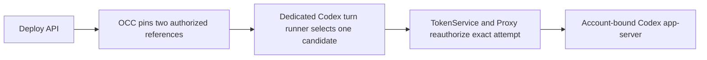

# Proposal: Ordered model credential Sources for dedicated Codex Agents

## Summary

Let an authorized deployer pin two existing Codex OAuth Sources in preference
order for a dedicated Kubernetes Agent. Reuse OpenClaw account selection,
cooldown and safe retry behavior while resolving each candidate through its OCE
Source authority. Try the reserve only after a definitive account-availability
failure before effects. Omission preserves the single-Source behavior.

## Motivation and scope

Today OCC snapshots one Harness Source, either directly selected or pinned by
one model credential grant. Native OpenClaw profile ordering works over
profiles in its own auth store; it cannot select between OCC-managed Sources.
Operators can deploy a replacement revision manually, but cannot automatically
handle a retryable account availability failure without changing revisions.

First delivery covers dedicated Kubernetes Codex with built-in OpenAI OAuth,
exactly two entries and identical model, effort and service tier across attempts.
No new enrollment, credential import, model fallback, cross-account thread
migration, other Harness or general routing service.

## Proposal

OCC owns admission and the immutable order; the dedicated turn runner owns the
attempt boundary. TokenService and Proxy keep custody and recheck the exact
revision, Agent principal, selected Source and grant generation when resolving
and using credentials. The app-server uses account-bound execution state and
receives only the existing guarded authentication material. Actual OAuth
credential bytes never enter the Gateway, workspace, logs or response.

Prefer rank one when it is eligible; preserve native session preference and
model-scoped cooldown behavior rather than forcing an exhausted account on each
turn. Fallback requires a **typed, definitive
pre-effect** account-availability outcome with current authority still intact.
Use the second entry at most once, within the original deadline. Do not classify
an arbitrary HTTP status or timeout as safe. A lost acknowledgment, uncertain
provider execution, response output, tool dispatch, or an account-bound thread
that cannot be continued on the reserve prohibits switching. Return the existing
interruption/terminal failure instead; do not replay. Authorization, ownership
or revocation failures are terminal, never a reason to switch. Recovery follows
the native eligibility policy; it does not force a healthy session to change
accounts. Admission must fail if the runtime cannot
enforce this attempt boundary or isolate the two account contexts.

### Reuse the native account policy

The inspected OpenClaw revision is `8a6d3a04ee74654ce03828eb91be4364bf734334`.
Its auth-profile order resolver, model-scoped cooldowns, auth controller and
failover retry controller already select another eligible account on the same
model. The assistant-failure policy prohibits rotation after output or an
ambiguous dispatched request. Extend that path with OCE-authorized candidates;
do not add a competing quota classifier, cooldown store or retry loop.

The missing connection is credential resolution, not account ordering. The
current dedicated runtime renders one external account descriptor. Each native
selection must instead resolve one admitted Source/grant at the existing
TokenService/Proxy boundary and preserve its attempt identity. Installing
`auth.order` alone cannot authorize or deliver another Source. Do not populate
the local auth store with actual managed OAuth tokens.

The integration must establish how account-bound Codex state can continue
without replaying effects. The inspected native runner and the OCE dedicated
app-server are different execution paths; native behavior alone does not prove
that the dedicated path can safely continue an existing conversation. This is
an implementation prerequisite, not permission to fall back to manual redeploy.

## Interface changes

### APIs

Add optional `modelCredentialOrder` to the existing Agent deploy body. It is
an ordered pair of discriminated references: `{kind:"local", sourceId}` or
`{kind:"delegated", sourceNamespaceId, sourceId, delegationId}`. Local namespace
is implicit. Reject duplicates, mixing custody modes in the initial delivery,
unsupported runtimes or Source types, and combining it with
`modelCredentialGrant` or an explicit single Harness Source. This new opt-in
uses a runtime-auth draft; existing draft and deploy inputs are unchanged. The
revision exposes order metadata to authorized readers, not resolved credentials.
No automatic provisioning or public credential-resolution endpoint.

### IAM

No new actions. Check the existing deploy authority and the applicable individual
Source permissions or preauthorized same-owner Agent grants for both entries.
A revision alone creates no entitlement. Revocation or loss of eligibility must
prevent further use under existing fencing; never rebind an old revision to a
replacement grant.

### Database entities

Extend the immutable revision credential snapshot with an optional ordered pair
of validated references and their custody coordinates; no new entity. Old rows
read and execute unchanged. Writers that do not understand the new snapshot
must not serve it as single-source.

### Driver contracts

Compute advertises support only when it can enforce the safe attempt and the
account-bound app-server contract. Extend the existing guarded credential
delivery context in TokenService/Proxy to bind the selected candidate to the
current revision and attempt. Do not give the runtime a general-purpose resolver
or authority over every Source in the Agent's Namespace. Driver contract changes
require this RFC to be submitted for human review before implementation.

## Simplifications

Keep manual single-Source redeploy as the simpler operational option; it
cannot satisfy transparent failover. Reuse OCC revision admission, Source
custody and revocation instead of adding a routing service. Do not simulate
OpenClaw native auth-profile ordering by copying managed OAuth credentials.

## Acceptance Criteria

Extend the existing Kubernetes dedicated Codex workflow integration proof through
the deploy API, revision admission, worker/runtime, guarded egress and actual chat
caller. Use an injected typed pre-effect availability outcome at a controlled
provider boundary; do not exhaust a real account to force failure.

| Case                                                                                                | Observable result                                                                                                                                        |
| --------------------------------------------------------------------------------------------------- | -------------------------------------------------------------------------------------------------------------------------------------------------------- |
| Omitted field; legacy revision                                                                      | Existing single Source, projection and response unchanged.                                                                                               |
| Healthy primary                                                                                     | Real response using first eligible Source only; selection and session preference follow native policy.                                                   |
| Definite pre-effect primary unavailability                                                          | One reserve attempt and one completed response with the exact same model, effort and tier; native cooldown prevents repeated exhausted-primary attempts. |
| Primary recovery                                                                                    | Cooldown expiry restores eligibility under native ordering, without forcing an unnecessary account switch in a healthy session.                          |
| Permission/ownership denial, revoked or stale grant, unknown outcome, partial output or tool effect | No reserve, no duplicate execution, no cross-account thread reuse; terminal or interrupted state observable.                                             |
| Concurrent attempts; wrong Agent/revision; unsupported runtime                                      | No account context bleed or credential resolution outside the admitted attempt; unsupported runtime rejects at admission.                                |

Capture redacted attempt rank, Source/grant reference, phase and outcome,
effective provider/model/effort/tier and terminal receipt. Qualify both accounts
on the exact installed runtime; catalog display alone is not admission proof.
For the initial internal qualification, require GPT-6.1 Sol, high reasoning
and Fast on both accounts, without a model or tier substitution.
Native browser acceptance is separate and requires a fresh assistant response.

## Delivery and verification

Submit this proposal before implementation; agree with maintainers on the
trusted pre-effect signal and supported account isolation mechanism. If the
pinned Codex runtime cannot provide both, keep the feature unavailable until
supported upstream. No code or proof of runtime behavior is delivered here.

## Related work

- [Multi-account plugin slots #4732](https://github.com/openclaw/openclaw-enterprise/pull/4732) and [per-call plugin account selection #4815](https://github.com/openclaw/openclaw-enterprise/issues/4815) select accounts for Google Workspace/MCP tools, not model quota failover.
- [Active Source rotation #7006](https://github.com/openclaw/openclaw-enterprise/pull/7006) replaces one Source's credential; it does not select a reserve account.
- [Multiple model selection #5305](https://github.com/openclaw/openclaw-enterprise/pull/5305) switches models, with automatic fallback explicitly separate.
- [Request-time model authorization RFC #4932](https://github.com/openclaw/openclaw-enterprise/pull/4932) and [implementation #5896](https://github.com/openclaw/openclaw-enterprise/pull/5896) own protected inference credentials. Reuse their authority boundaries rather than creating a parallel delivery mechanism.

## References

- [Cross-namespace model credential delegation proposal #7528](https://github.com/openclaw/openclaw-enterprise/pull/7528)
- [Harness authentication](../../docs/reference/harness-execution.md)
- [Credential Source lifecycle](../../docs/flows/credential-source-lifecycle.md)
- [Existing deploy schema](../../packages/contracts/src/api/common.ts)
- [Existing admission path](../../packages/occ/src/agent-deployment-admission.ts)
- [Native profile selection and cooldown](https://github.com/openclaw/openclaw/blob/8a6d3a04ee74654ce03828eb91be4364bf734334/src/agents/auth-profiles/order.ts)
- [Native failover and replay policy](https://github.com/openclaw/openclaw/blob/8a6d3a04ee74654ce03828eb91be4364bf734334/src/agents/embedded-agent-runner/run/assistant-failure.ts)
