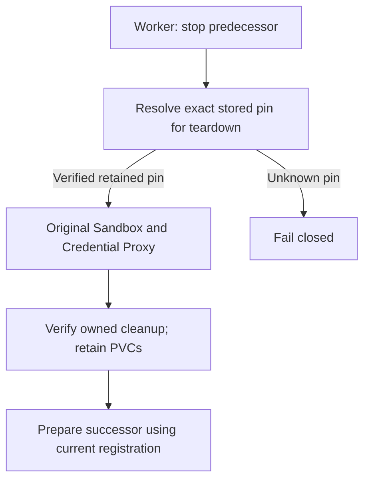

# Proposal: Retain staged Driver registrations for retirement

- **ID:** RFC-20261128-staged-driver-retirement
- **Created:** 2026-11-28
- **Last updated:** 2026-11-28

## Problem and decision

When a supported Installation change alters a staged Driver configuration hash, existing revisions retain the former pin. An exclusive replacement stops every predecessor before preparing its candidate. The current registration cannot stop a predecessor that has a different pin, even when both registrations have the same ID and implementation. Neither ordinary Stop nor another deployment repairs this mismatch.

Retain explicitly supplied previous registrations for cleanup only. Compute and the worker must select the same exact historical Sandbox and Credential Proxy pair when retiring a pinned revision. New admission, preparation, activation and runtime use must continue to resolve exclusively through the current registration.

## Ownership and safety

The Installation operator supplies original definitions through protected startup configuration. Composition validates them normally, recomputes the full reference and rejects duplicates or ambiguous registrations. A retained registration must not create workload or authorize new credential delivery. An unrecognized pin or inaccessible original provider leaves the retirement incomplete. An empty Kubernetes result is not sufficient proof of external credential withdrawal.

Existing ownership checks, fencing, UID/resourceVersion preconditions, drain order, and credential settlement stay in force. Retry an uncertain cleanup through the same exact pin. Do not edit historical revision records or grant a fallback to the current Driver.

## Interface changes

### API

No changes.

### IAM

No changes.

### Database entities

No changes.

### Driver contract

Protected startup configuration gains optional retained staged registration definitions, using the same validated definitions as current composition. Teardown resolves the complete recorded reference; no matches by ID alone. Existing behavior is unchanged when the current reference matches. Exact schema and compatibility validation are to be reviewed before shipping.

## Simplifications

A global rollback to the old configuration makes new revisions incompatible. Ignoring the hash or treating missing workloads as completed retirement could leave credentials accessible. Reusing validated registration composition and exact teardown avoids both problems without a second control plane or new retirement API.

## Acceptance criteria

- Against an isolated cluster, deploy an Agent under A. Change to B retaining A, use the ordinary Agent replacement flow, verify teardown of the exact predecessor under A and activation plus a real synthetic turn under B. Retain original PVC UIDs.
- Unknown A, foreign resource ownership or unreachable original custody prevent activation; repeated cleanup retains exact identity and respects concurrent replacement.
- No new revision can be admitted or activated using A. Confirm no external provider or platform data is mutated by validating malformed retained configurations.
- Verify current-pin Stop, ordinary replacement and startup remain unchanged. Report any unrun real-cluster coverage separately.
